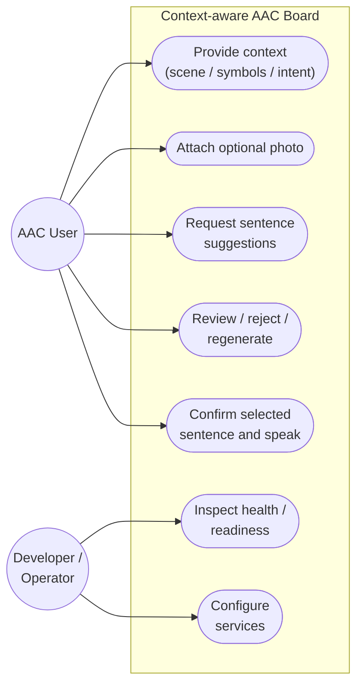
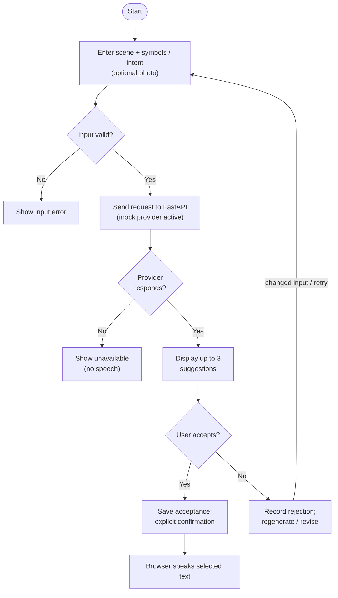
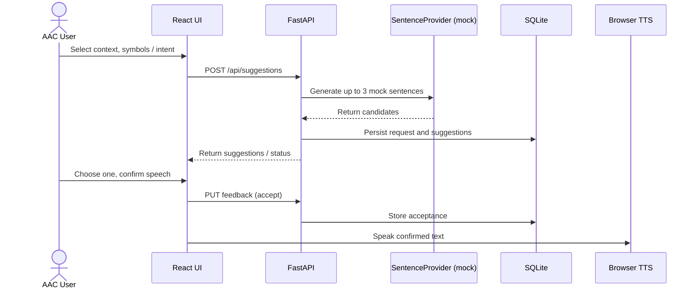
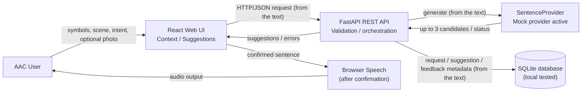
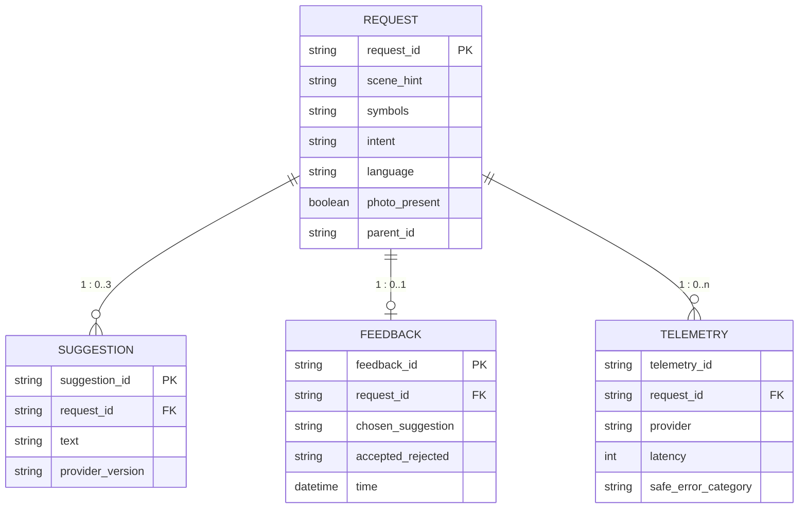
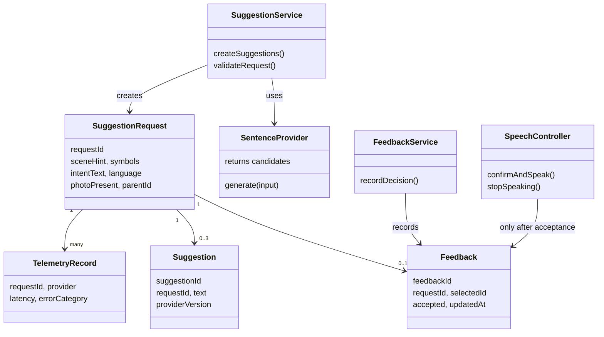
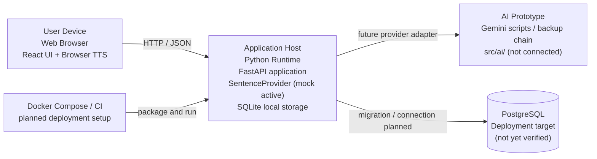

# Software Architecture Document — Context-aware AAC Board

**Beihang University · B — The Outliers**

*A context-aware communication assistant for everyday English requests*

> **Transcription note.** This file is a Markdown transcription of the review draft SAD delivered as a PDF on 17 November 2026 (25 pages, generated with Word). The PDF calls itself "SAD review draft v1.0"; in the team's numbering it is **SAD v0.2**. The text and tables are kept as written. The seven figures were raster images in the PDF; they are redrawn here in Mermaid with the same boxes, arrows and labels.
>
> Things found while transcribing, kept as they are in the text:
>
> - **Figures under the wrong headings.** In the PDF, the pictures follow the order of the *List of Figures* (DFD, sequence, use case, activity, ERD, class, deployment), but the body captions follow the section order (use case, activity, sequence, DFD, …). So the picture under "Figure 1: Use Case Diagram" is the DFD, under "Figure 2: Activity Diagram" the sequence diagram, under "Figure 3: Sequence Diagram" the use case diagram, and under "Figure 4: Data Flow Diagram" the activity diagram. Here each diagram is placed under the heading it belongs to.
> - **Section numbers.** Views and diagrams share numbers (3.1 User Interaction View and 3.1 Use Case Diagram; 3.2 Runtime Data-Flow View and 3.2 Activity Diagram; …). They are kept.
> - **Labels that cannot be read.** In the DFD three arrow labels are hidden under other arrows. They are completed from the section text and marked *(from the text)*.
> - **Class diagram cardinalities.** In the PDF the label "1 to many" is drawn on the arc to Feedback and "1 to 0..1" near Suggestion. The ERD and its text say Request–Feedback is 1 : 0..1 and Request–Telemetry is 1 : 0..n; the labels are placed that way here.
>
> - **One label changed.** The sequence message "Choose one; confirm speech" is written "Choose one, confirm speech", because Mermaid reads a semicolon as the end of a line.
>
> Differences between this draft and the code on `main` are not corrected here. They are listed and resolved in [SAD v0.3](SAD_v0.3.md), section 4.3.

---

## Document control

| | Value |
| --- | --- |
| Team | B — The Outliers |
| Authors | Veronika Surianinova · Jiahui Chen · Thibaut de Robien · Abid Ali |
| Course / institution | Software Engineering · Beihang University |
| Architecture baseline | Team SRS v0.5, dated 29 October 2026 |
| SAD template | SEI Views and Beyond Architecture Documentation Template |
| Edition | SAD review draft v1.0 (team numbering: v0.2) |
| Status | Course project architecture; implementation and planned components distinguished |
| Scope | Standalone web-first prototype · English only · café scenario first |

## Revision History

| Revision | Date | Change summary | Status |
| --- | --- | --- | --- |
| 1.0 | 17 November 2026 | Initial project-specific SAD prepared from SRS v0.5 using the supplied SEI template; seven required diagrams added. | Review draft |

## Table of Contents

- 1 Documentation Roadmap
  - 1.1 Document Management and Configuration Control Information
  - 1.2 Purpose and Scope of the SAD
  - 1.3 How the SAD Is Organized
  - 1.4 Stakeholder Representation
  - 1.5 Viewpoint Definitions (1.5.1 User Interaction · 1.5.2 Runtime Data-Flow · 1.5.3 Data and Domain Structure · 1.5.4 Deployment)
  - 1.6 How a View Is Documented
  - 1.7 Relationship to Other SADs
  - 1.8 Process for Updating this SAD
- 2 Architecture Background
  - 2.1 Problem Background (2.1.1 System Overview · 2.1.2 Goals and Context · 2.1.3 Significant Driving Requirements)
  - 2.2 Solution Background (2.2.1 Architectural Approaches · 2.2.2 Analysis Results · 2.2.3 Requirements Coverage · 2.2.4 Summary of Background Changes)
  - 2.3 Product Line Reuse Considerations
- 3 Views
  - 3.1 User Interaction View
  - 3.2 Runtime Data-Flow and Component View
  - 3.3 Data and Domain Structure View
  - 3.4 Deployment View
- 4 Relations Among Views (4.1 General Relations · 4.2 View-to-View Relations)
- 5 Referenced Materials
- 6 Directory (6.1 Index · 6.2 Glossary · 6.3 Acronym List)
- Appendix A — Diagram and implementation status

**List of Figures** (as numbered in the PDF list)

1. Data Flow Diagram (DFD)
2. Sequence Diagram
3. Use Case Diagram
4. Activity Diagram
5. Entity–Relationship Diagram (ERD)
6. Class Diagram
7. Deployment Diagram

**List of Tables**

1. Stakeholders and Relevant Viewpoints · 2. Viewpoint Summary · 3. Architectural Drivers and SRS Traceability · 4. DFD Elements · 5. Sequence Diagram Elements · 6. Use Case Elements · 7. Activity Diagram Elements · 8. ERD Entities · 9. Class Diagram Elements · 10. Deployment Nodes · 11. Requirements Coverage · 12. View-to-View Relations · 13. Glossary

---

## 1 Documentation Roadmap

This Software Architecture Document (SAD) describes the architecture of Team B — The Outliers' Context-aware AAC Board. It is intended as a navigation guide for the instructor, project members, reviewers, testers and future maintainers. The document follows the supplied SEI Views and Beyond template and organizes the architecture into stakeholder-oriented views. It focuses on elements, externally visible responsibilities, interfaces, interactions, data records and deployment relationships that influence system behavior.

### 1.1 Document Management and Configuration Control Information

The SAD is a course-project design baseline derived from SRS v0.5 (29 October 2026). Revision 1.0 is the first project-specific SAD based on the professor-provided template. Changes to architecture, API contracts, data records, provider selection or deployment assumptions should be recorded with the affected SRS requirement identifiers and reviewed by the team before the document is reissued.

| Item | Current value |
| --- | --- |
| Revision number | 1.0 — review draft |
| Release date | 17 November 2026 |
| Content owner | Team B — The Outliers; team review required |
| Purpose of revision | Create a project-specific SAD conforming to the supplied SEI template |
| Scope of revision | Documentation roadmap, architecture background, four architecture views, seven diagrams, cross-view relations and directory |

### 1.2 Purpose and Scope of the SAD

This SAD specifies the software architecture of the standalone, English-language, browser-based Context-aware AAC Board. The product helps an AAC user communicate an everyday request by selecting a scene, one or more symbol tiles, optional intention text and optionally a photo; the application returns up to three candidate English sentences. The user reviews the candidates and must explicitly confirm a selected sentence before browser speech output is initiated. The user may reject candidates, request regeneration, change context or stop speech.

The architecture boundary includes the React web client, the FastAPI REST backend, request validation and orchestration, the replaceable SentenceProvider abstraction, local SQLite persistence, feedback and reuse behavior, optional image validation and browser speech output. The AI model scripts in `src/ai/` are documented as a separate prototype and are not shown as an active runtime dependency because the SRS states they are not yet connected to the backend. PostgreSQL, Docker Compose deployment, public hosting, secure account authentication and production security controls remain planned or awaiting verification.

Architectural information is included where it affects interactions between components: service responsibilities, APIs, data exchanged, persistence, error behavior, provider substitution, speech authorization and deployment boundaries. Low-level styling, individual source-code statements and detailed test implementation are outside the architecture scope unless they affect an interface or architectural quality.

### 1.3 How the SAD Is Organized

Section 1 provides document control, scope, stakeholder concerns and the viewpoints used. Section 2 explains the system problem, architectural goals, driving requirements, design choices and known analysis results. Section 3 presents the seven required diagrams grouped into user-interaction, runtime data-flow, data/domain and deployment views. Section 4 explains how those views map to one another. Section 5 lists the SRS, project repository and relevant standards or research. Section 6 provides an index, glossary and acronym list.

### 1.4 Stakeholder Representation

The architecture is written for stakeholders who need to understand the system's responsibilities, behavior, implementation boundaries and readiness. The AAC user is the primary beneficiary; the instructor and team need a design that can be reviewed and implemented within course milestones; developers and testers need stable component contracts and traceable evidence; the operator needs to understand configuration, health checks, storage and deployment dependencies.

*Table 1. Stakeholders and Relevant Viewpoints*

| Stakeholder | Primary concerns | Relevant viewpoints |
| --- | --- | --- |
| AAC user | Clear symbols and text, user control, safe confirmation before speech, predictable rejection and retry | User interaction; runtime data flow |
| Support person / caregiver | Assistive use without overriding user intention; optional photo path | User interaction; runtime data flow |
| Course instructor / reviewer | Completeness, traceability, realistic implementation status and design rationale | All views |
| Frontend developer (Thibaut) | Symbol board, optional photo, navigation and suggestion/speech controls | User interaction; runtime data flow |
| Backend developer (Veronika) | FastAPI contracts, validation, persistence, migrations and feedback | Runtime data flow; data/domain |
| AI/provider lead (Jiahui) | SentenceProvider boundary, prompts, model evaluation and fallback limits | Runtime data flow; data/domain |
| Deployment/security lead (Abid Ali) | Configuration, CI/deployment planning, access controls and operational limits | Deployment; runtime data flow |
| Tester / maintainer | Repeatable scenarios, errors, logs, data integrity and change impact | All views |

### 1.5 Viewpoint Definitions

A viewpoint defines the concerns and modeling conventions used to describe one aspect of the architecture. This SAD uses four viewpoints that collectively cover the seven diagrams requested for the course and the architectural concerns recorded in SRS v0.5.

*Table 2. Viewpoint Summary*

| Viewpoint | Diagrams | Concerns addressed |
| --- | --- | --- |
| User interaction | Use case; activity; sequence | Actors, user goals, request flow, decision points and confirmation |
| Runtime data-flow and component | DFD; sequence | Runtime components, connectors, request/response movement, provider and persistence interactions |
| Data and domain structure | ERD; class diagram | Persistent records, logical relationships, responsibilities and service/domain concepts |
| Deployment | Deployment diagram | Execution nodes, network boundaries, current local arrangement and planned deployment targets |

#### 1.5.1 User Interaction Viewpoint

- **Abstract:** Represents how the AAC user and developer/operator interact with the system, including the main request journey and its decision points.
- **Stakeholders and concerns addressed:** AAC users, support persons, instructor, frontend developer and testers. It answers: what can an AAC user do; when is speech permitted; what happens when input is invalid, no provider response is available or suggestions are rejected?
- **Elements, relations, properties and constraints:** Actors include AAC User and Developer/Operator. Use cases include providing context, attaching an optional photo, requesting suggestions, reviewing/rejecting/regenerating, confirming and speaking, stopping speech, configuring services and inspecting health. Activity nodes represent validation and user decisions. Sequence messages represent UI/API/provider/storage interactions.
- **Languages to model/represent conforming views:** UML use-case, activity and sequence notation. The diagrams are conceptual and aligned with the SRS use case and activity workflow.
- **Applicable evaluation/analysis techniques and consistency criteria:** Check that each user-visible action maps to a described service behavior; confirm speech occurs only after explicit confirmation; verify all failure paths end in visible status and no unintended speech.
- **Viewpoint source:** SEI Views and Beyond structure; UML 2.x notation; project workflow in SRS v0.5.

#### 1.5.2 Runtime Data-Flow Viewpoint

- **Abstract:** Shows runtime components and the movement of data through the web client, backend, sentence provider, storage and browser speech output.
- **Stakeholders and concerns addressed:** Frontend/backend developers, AI lead, testers and operator. It answers: where is input validated; which provider is active; what is stored; how suggestions and errors return to the UI?
- **Elements, relations, properties and constraints:** Elements are React UI, FastAPI routes/services, SentenceProvider, SQLite, optional image processing, feedback/reuse operations and browser speech. Connectors are HTTP/JSON requests, internal provider calls, database operations and browser speech APIs.
- **Languages to model/represent conforming views:** Data-flow diagram and UML sequence diagram; arrows indicate direction and label the data or operation.
- **Applicable evaluation/analysis techniques and consistency criteria:** Verify that every data flow has a source and destination; raw photos are not persisted; the active backend provider is mock; AI prototype and PostgreSQL target are marked planned/unconnected.
- **Viewpoint source:** SEI component-and-connector viewpoint; project API and architecture records in SRS v0.5.

#### 1.5.3 Data and Domain Structure Viewpoint

- **Abstract:** Describes the logical records and conceptual classes that support requests, generated suggestions, user feedback and operational telemetry.
- **Stakeholders and concerns addressed:** Backend developer, data designer, tester and maintainer. It answers: what records are linked to a request; how are suggestions and feedback associated; which service owns each operation?
- **Elements, relations, properties and constraints:** Logical entities include Request, Suggestion, Feedback and Telemetry. Conceptual classes include SuggestionRequest, Suggestion, Feedback, TelemetryRecord, SuggestionService, SentenceProvider, FeedbackService and SpeechController. Exact ORM/database fields are subject to the implementation schema.
- **Languages to model/represent conforming views:** ERD and UML class diagram.
- **Applicable evaluation/analysis techniques and consistency criteria:** Check referential relationships, request identifiers, optional parent request linkage and the rule that raw photographs are not retained. Distinguish logical model from a final physical schema.
- **Viewpoint source:** SRS v0.5 Appendix D and API/data responsibilities.

#### 1.5.4 Deployment Viewpoint

- **Abstract:** Shows where the software executes and separates the current local prototype from planned deployment infrastructure.
- **Stakeholders and concerns addressed:** Deployment lead, instructor, tester and future operator. It answers: which node hosts the browser, API and database; what is current; what is not yet verified?
- **Elements, relations, properties and constraints:** Nodes include user device/browser, local application host, SQLite, AI prototype scripts, planned PostgreSQL target and planned Docker Compose/CI setup. Communication uses HTTP/JSON and provider/database connections.
- **Languages to model/represent conforming views:** UML deployment diagram.
- **Applicable evaluation/analysis techniques and consistency criteria:** Verify that current local SQLite and mock-provider execution are not confused with planned PostgreSQL, connected AI or public hosting. Deployment acceptance requires environment and integration checks.
- **Viewpoint source:** SEI allocation viewpoint; SRS v0.5 product perspective and Appendix D/E.

### 1.6 How a View Is Documented

Each view begins with its purpose and scope, followed by an element table, an explanatory design narrative, the diagram, and a diagram interpretation. Interfaces, relationships, constraints and implementation status follow the figure. This sequence is repeated for each of the seven diagrams so that readers can understand the inventory before inspecting the visual representation.

### 1.7 Relationship to Other SADs

No separate system-level or subsystem-level SAD is identified for this course project. This document is the single architecture description for the Context-aware AAC Board. The SRS remains the normative source for required behavior and acceptance criteria; this SAD explains the architecture that realizes or is planned to realize those requirements.

### 1.8 Process for Updating this SAD

A proposed change should identify the reason, owner, affected component or interface, related SRS requirement IDs, expected impact on the seven diagrams and any verification evidence that must change. The team should review API and data-model changes with both frontend and backend owners, provider changes with the AI lead, and deployment/security changes with the deployment lead. The content owner should approve the revision before release. Open decisions in SRS v0.5 remain open until a team decision and supporting evidence are recorded.

---

## 2 Architecture Background

### 2.1 Problem Background

#### 2.1.1 System Overview

The Context-aware AAC Board is a standalone web application intended to reduce the amount of typing needed to communicate everyday requests in English. The user supplies explicit context through a scene hint, symbol tiles and optional intention text; an optional image may provide additional context. The backend validates the request and returns up to three sentence candidates. The user—not the image or model—decides which sentence expresses the intended message. Only after an explicit confirmation may the browser speech capability speak the selected text.

#### 2.1.2 Goals and Context

The architecture supports a small, demonstrable café-first workflow while keeping the sentence-generation provider replaceable. It separates user interaction from API orchestration and persistence, enabling the frontend and backend to be developed and tested independently. It also makes the current implementation boundary explicit: the backend uses fixed mock templates; real Gemini/Ollama/OpenAI-compatible adapters exist in a prototype area but are not registered in the active backend; SQLite is the tested local storage; PostgreSQL and public deployment remain planned or unverified.

#### 2.1.3 Significant Driving Requirements

*Table 3. Architectural Drivers and SRS Traceability*

| Driving concern | Architectural response | SRS linkage |
| --- | --- | --- |
| User-controlled speech | Separate suggestion review, acceptance feedback and browser speech; speak only after confirmation | REQ-FUNC-005 to REQ-FUNC-007 |
| Validated client/server contract | React sends structured HTTP/JSON requests to FastAPI endpoints with stable error responses | REQ-INT-004 |
| Replaceable generation logic | SentenceProvider abstraction isolates mock templates from future provider adapters | REQ-INT-005 |
| Optional and privacy-aware image path | Validate supported image input, resize/remove metadata before provider use; do not persist raw photos | REQ-INT-003; REQ-ML-004; REQ-SEC / privacy requirements |
| Persistence and regeneration | Store request/suggestion/feedback metadata and link regeneration chain; support reuse of accepted text | REQ-FUNC-009; REQ-ML-008 |
| Operational visibility | Health/readiness endpoints and safe error categories | REQ-REL-001 to REQ-OBS-001 |
| Deployment readiness | Separate local prototype from Docker Compose, PostgreSQL, hosting and security work that remains open | REQ-INST-001; REQ-DIST-001; REQ-PORT-001 |

### 2.2 Solution Background

#### 2.2.1 Architectural Approaches

The architecture uses a web-client/API separation. The React frontend owns the interaction flow and browser speech output; the FastAPI backend owns validation, generation orchestration, feedback and service status. The SentenceProvider abstraction isolates sentence generation so the active mock provider can be replaced without changing the external API contract. Persistence is accessed through the backend and currently uses SQLite in the tested local starter. This is a lightweight arrangement appropriate for the course prototype and avoids claiming a production microservice architecture.

The design is layered by responsibility rather than deployed as multiple independent services. The browser communicates with the API over HTTP/JSON. Backend routes delegate to validation and service logic, then to the provider abstraction and persistence layer. Optional image handling is performed before provider use. The browser's speech capability is invoked only after the user confirms the selected sentence. AI backup-chain scripts are a separate prototype and are not represented as an active backend runtime component.

#### 2.2.2 Analysis Results

The SRS v0.5 reports 108 automated tests passing on the main branch as of 29 October 2026, with backend validation, API routes, error codes, persistence and migrations represented in the verification evidence. The reuse endpoint was merged and a local Swagger response was demonstrated. The same SRS explicitly records that real AI inference is not connected to the backend, PostgreSQL deployment is not verified, actual voice playback and browser click-through require manual checks, authentication is not proven by the login screenshot, and public deployment remains incomplete. These are status facts, not architectural assumptions.

#### 2.2.3 Requirements Coverage

*Table 11. Requirements Coverage*

| Requirement area | Architectural elements | Coverage statement |
| --- | --- | --- |
| External interfaces | React UI, FastAPI routes, browser file input and speech output | Client/API contract and browser interaction path are described; device-level speech verification remains open. |
| Functional workflow | Context capture, suggestion service, feedback service, reuse endpoint | Core request, review, accept/reject and regeneration flow is represented; mock generation is active. |
| Quality and reliability | Validation, stable error responses, health/readiness, persistence | Error and status boundaries are represented; production performance/availability require further evidence. |
| Security and privacy | Image sanitization, no raw photo persistence, planned authentication and access controls | Privacy-related image handling is represented; secure login and public deployment controls are not yet verified. |
| AI/ML | SentenceProvider interface and separate AI prototype | Replaceability is architectural; live AI integration and evaluation remain future work. |
| Deployment | Local host, SQLite, planned PostgreSQL and Docker Compose | Current and planned environments are separated in the deployment view. |

#### 2.2.4 Summary of Background Changes Reflected in Current Version

The architecture follows the SRS v0.5 baseline, which supersedes the earlier proposal to extend Cboard. The application is treated as a standalone product; Cboard is inspiration only and no Cboard source code or assets are assumed. The current SAD also reflects the SRS correction that the backend uses a mock provider, while real provider scripts are only a separate prototype. The storage and deployment descriptions distinguish tested SQLite from planned PostgreSQL and Docker Compose.

### 2.3 Product Line Reuse Considerations

The project is not currently documented as a software product line and no committed family of deployable variants is specified. Limited reuse is supported at the component boundary: the SentenceProvider interface can allow alternative generation implementations without changing the API contract, and accepted-sentence reuse can return a prior matching sentence without a new provider call. These are component-level extension points, not evidence of a fully configurable product line. Future variants such as additional locations, languages or mobile packaging require explicit scope and change approval.

---

## 3 Views

The architecture is presented through four complementary views. The seven diagrams below are grouped by their primary architectural concern. For each diagram, the component table is presented first, followed by a narrative explanation, the diagram, and a concise interpretation of the diagram's elements and relationships.

### 3.1 User Interaction View

This view describes the user-visible behavior and the interactions that connect the AAC user to the application. It includes the use case, activity and sequence diagrams. It is based on the café scenario and the user-control rule specified in SRS v0.5.

### 3.1 Use Case Diagram

This design element is documented for the Context-aware AAC Board using the project baseline in SRS v0.5. The table identifies the principal elements and their architectural role before the explanatory description and diagram.

*Table 6. Use Case Elements*

| Element / record | Responsibility or meaning | Implementation status |
| --- | --- | --- |
| AAC User | Provides scene, symbols, optional intent/photo; requests and reviews suggestions; confirms or rejects; stops speech | Primary actor |
| Developer / Operator | Configures services and inspects health/readiness | Operational actor |
| Context entry | Scene hint, symbol labels and optional intention text | Implemented UI flow; API validation |
| Photo input | Optional image file supplied as contextual input | Input path documented; processing limitations apply |
| Suggestion request | Requests up to three English candidates | Mock provider active |
| Review and decision | Accepts a candidate or rejects and regenerates | Feedback endpoint implemented |
| Confirm and speak | Explicitly authorizes speech for the selected sentence | Browser/device verification outstanding |
| Health/readiness | Checks service liveness/readiness | Endpoints reported implemented |

**Design explanation.** The AAC User is the central actor because the product is designed to preserve the user's agency. The user supplies the context, requests candidates, reviews their content and makes the final decision. The system does not autonomously speak a generated sentence. The Developer/Operator actor is separate and performs operational tasks rather than participating in the communication request. The login screen is present in the interface, but SRS v0.5 states that authentication is planned and must not be treated as verified access control.

*Figure 1: Use Case Diagram* (in the PDF this picture appears under the Figure 3 caption)

**Diagram details and interpretation**

- The system boundary contains the web application functions; the AAC User and Developer/Operator remain external actors.
- Providing context may combine scene hint, one or more symbol labels and optional free text; photo input is optional.
- Suggestion generation is separated from user acceptance. A candidate being displayed does not authorize speech.
- The confirm-and-speak use case depends on explicit user action; Stop Speaking is a separate control.
- Health/readiness operations are intended for developers/operators, not as part of the AAC user's core request.

### 3.2 Activity Diagram

This design element is documented for the Context-aware AAC Board using the project baseline in SRS v0.5. The table identifies the principal elements and their architectural role before the explanatory description and diagram.

*Table 7. Activity Diagram Elements*

| Element / record | Responsibility or meaning | Implementation status |
| --- | --- | --- |
| Start / context entry | User opens the workflow and enters a scene, symbols and/or intention | UI flow |
| Input validation | Checks that a symbol or intention is present and that request fields are valid | Backend validation |
| Suggestion generation | FastAPI calls the active SentenceProvider and requests up to three candidates | Mock provider active |
| Provider failure | Returns an unavailable status and visible message; no speech is initiated | Error path |
| Review and decision | User reviews suggestions and accepts or rejects | User decision |
| Feedback and speech | Acceptance is saved; only the confirmed sentence is passed to browser speech | Speech verification outstanding |
| Regeneration | Rejection is recorded and a new request is generated without repeating earlier unchanged-input suggestions | Implemented behavior described in SRS |

**Design explanation.** The activity diagram models the control flow rather than the internal class structure. It begins with the user's context and validates that a meaningful request exists. Invalid input produces a visible error. A valid request is sent to FastAPI, where the mock provider currently generates candidate sentences. If generation is unavailable, the interface reports the failure and does not speak. If suggestions are returned, the user chooses whether to accept one or reject the set. Acceptance is persisted before speech; rejection triggers a regeneration path or a return to context editing. This control flow enforces the central safety property that generated text cannot speak without user confirmation.

*Figure 2: Activity Diagram* (in the PDF this picture appears under the Figure 4 caption)

**Diagram details**

- The validation decision prevents an empty symbol-and-intent request from proceeding to generation.
- Provider failure is a terminal visible error for that attempt; no fallback speech is allowed.
- The acceptance branch saves the user's decision before initiating browser speech.
- The rejection branch records the decision and requests alternatives without repeating previous unchanged-input candidates.
- The user can change the context and start a new request rather than being forced to accept a candidate.

### 3.3 Sequence Diagram

This design element is documented for the Context-aware AAC Board using the project baseline in SRS v0.5.

*Table 5. Sequence Diagram Elements*

| Element / record | Responsibility or meaning | Implementation status |
| --- | --- | --- |
| AAC User | Selects context and later chooses/confirms a sentence | External actor |
| React UI | Collects inputs, sends request, displays candidates and invokes browser speech | Frontend |
| FastAPI | Validates, orchestrates provider call and records feedback | Backend |
| SentenceProvider | Returns candidate text; current registered implementation is mock | Active provider |
| SQLite | Stores request, suggestion and feedback metadata | Local tested store |
| Browser TTS | Speaks only the confirmed selected text | Browser capability |

**Design explanation.** The sequence diagram shows a successful end-to-end request and the order in which participants exchange messages. The user first supplies context through the React UI. The UI submits a structured request to FastAPI. The backend validates the request and calls the SentenceProvider, which currently resolves to the mock implementation. The backend persists the request and returned candidates in SQLite before returning the suggestions to the UI. The user then selects a candidate and confirms speech. The UI sends the acceptance decision to the feedback endpoint; after confirmation, the selected text is passed to the browser speech facility. The sequence intentionally does not show a live AI model as an active participant.

*Figure 3: Sequence Diagram* (in the PDF this picture appears under the Figure 2 caption)

**Diagram details and interpretation**

- Lifelines represent independent participants, not necessarily separate physical servers.
- The provider response is candidate text; the UI remains responsible for presenting the choices and collecting the user's decision.
- Persistence records the request and suggestions before the user accepts a candidate; acceptance is recorded separately.
- The browser speech action is downstream of explicit confirmation and must not be triggered by generation alone.
- Failure responses can replace the successful provider-response branch; they are surfaced to the UI and do not initiate speech.

**Interfaces and relationships.** `POST /api/suggestions` is used for generation; `PUT /api/requests/{request_id}/feedback` records acceptance or rejection. The provider is invoked through the SentenceProvider abstraction. SQLite is the currently tested local database.

**Constraints and status.** This diagram represents the successful interaction path. Provider timeout, HTTP error, invalid input and no-suggestion branches are specified in the SRS activity/error handling and are not expanded into separate lifelines here. Live AI adapter registration and end-device speech verification remain outstanding.

### 3.2 Runtime Data-Flow and Component View

This view describes the movement of data through the runtime system and the component boundaries that process it. It documents the DFD first, while the sequence diagram in Section 3.1 provides the time-ordered interaction detail.

### 3.4 Data Flow Diagram (DFD)

This design element is documented for the Context-aware AAC Board using the project baseline in SRS v0.5. The table identifies the principal elements and their architectural role before the explanatory description and diagram.

*Table 4. DFD Elements*

| Element / record | Responsibility or meaning | Implementation status |
| --- | --- | --- |
| AAC User | Supplies symbols, scene hint, intent text and optional image | External source |
| React Web UI | Collects user input and displays suggestions/errors | Frontend |
| FastAPI REST API | Validates input, orchestrates generation, feedback and reuse | Backend |
| SentenceProvider | Returns up to three candidate sentences | Mock active; replaceable |
| SQLite | Persists request, suggestion and feedback metadata | Local tested database |
| Browser Speech | Outputs confirmed English sentence | Client-side capability |

**Design explanation.** The DFD describes the logical flow of information across the system boundary. The user sends context through the React interface. The interface transmits structured data to FastAPI using HTTP/JSON. The backend validates the payload, invokes the SentenceProvider and returns candidate sentences or a stable error response. Request, suggestion and feedback metadata are stored in SQLite. Once the user confirms a candidate, the browser's speech engine produces audio. Optional image bytes are validated and sanitized before provider use; raw photos are not intended to be stored. The AI prototype and planned PostgreSQL target are deliberately not drawn as active data-flow components.

*Figure 4: Data Flow Diagram (DFD)* (in the PDF this picture appears under the Figure 1 caption)

**Diagram details and interpretation**

- User input is explicit and may contain scene hint, symbol labels, intent text and optional photo data.
- The frontend/backend boundary is HTTP/JSON; the API contract defines suggestion, image, feedback, reuse, health and readiness operations.
- The SentenceProvider is replaceable; the backend currently registers the mock provider only.
- Persistence stores metadata and feedback, not raw photographs.
- Speech output is a client-side flow that occurs only after the user confirms the selected sentence.

### 3.3 Data and Domain Structure View

This view describes the information records and conceptual software responsibilities that support the communication workflow. The ERD reflects the logical records named in SRS Appendix D. The class diagram is a conceptual responsibility model and should not be interpreted as an exact source-code class inventory or finalized ORM schema.

### 3.5 Entity–Relationship Diagram (ERD)

This design element is documented for the Context-aware AAC Board using the project baseline in SRS v0.5. The table identifies the principal elements and their architectural role before the explanatory description and diagram.

*Table 8. ERD Entities*

| Element / record | Responsibility or meaning | Implementation status |
| --- | --- | --- |
| Request | request_id; scene_hint; selected labels; intent; language; photo_present; parent_id | Logical record in SRS Appendix D |
| Suggestion | suggestion_id; request_id; text; provider_version | Candidate linked to a request |
| Feedback | request_id; chosen suggestion; acceptance/rejection; update timestamp | User decision record |
| Telemetry | provider identity; latency; safe error category; request link | Operational metadata |
| Image payload | Temporary validated bytes for provider use; raw photo not retained | Transient input, not persistent entity |

**Design explanation.** The ERD presents the logical data relationships described in the SRS. A request is the parent record for the candidate suggestions generated for one interaction. The same request may have a feedback record describing the user's acceptance or rejection and the selected suggestion. Telemetry can be associated with a request to support provider and latency analysis using safe error categories. Regeneration requests may be linked through a parent request identifier. The diagram is intentionally logical: the SRS identifies representative fields but does not provide a complete final physical database schema in this section.

*Figure 5: Entity–Relationship Diagram (ERD)*

*Note in the figure: Raw photographs are not stored. Image presence/processing metadata may be recorded.*

**Diagram details and interpretation**

- One Request may be associated with zero to three Suggestion records for a generation attempt.
- A Request may have zero or one current Feedback decision record, subject to the backend's update behavior.
- A Request may have multiple telemetry events or a single summarized telemetry record; the exact physical cardinality is implementation-specific.
- `parent_id` supports linking a regeneration to the prior request in the same generation chain.
- Raw photographs are not stored; photo presence and safe processing metadata may be retained.

### 3.6 Class Diagram

This design element is documented for the Context-aware AAC Board using the project baseline in SRS v0.5. The table identifies the principal elements and their architectural role before the explanatory description and diagram.

*Table 9. Class Diagram Elements*

| Element / record | Responsibility or meaning | Implementation status |
| --- | --- | --- |
| SuggestionRequest | Represents a user request and its context fields | Conceptual domain class |
| Suggestion | Represents one candidate sentence returned for a request | Conceptual domain class |
| Feedback | Represents acceptance or rejection and selected candidate | Conceptual domain class |
| TelemetryRecord | Represents provider/latency/safe error metadata | Conceptual domain class |
| SuggestionService | Validates request and coordinates generation | Backend responsibility |
| SentenceProvider | Abstraction that returns candidate sentences | Interface; mock registered |
| FeedbackService | Records the user's decision | Backend responsibility |
| SpeechController | Triggers/stops browser speech after confirmation | Frontend responsibility |

**Design explanation.** The class diagram separates domain records from service responsibilities. SuggestionRequest, Suggestion, Feedback and TelemetryRecord describe the logical information handled by the system. SuggestionService coordinates validation and generation, while SentenceProvider defines the replaceable boundary for the generation implementation. FeedbackService records the user's decision. SpeechController represents the frontend responsibility for passing only a confirmed sentence to the browser speech capability. This conceptual separation helps the team reason about responsibilities without asserting that each box already exists as a class with the same name in the code.

*Figure 6: Class Diagram*

**Diagram details and interpretation**

- SuggestionRequest is associated with candidate Suggestion objects through requestId.
- Feedback references the request and, when accepted, the selected suggestion identifier or text.
- SuggestionService depends on the SentenceProvider interface rather than on a specific hosted model.
- FeedbackService owns the acceptance/rejection persistence operation.
- SpeechController is invoked only after a user confirmation event; generation services do not directly initiate audio.

### 3.4 Deployment View

The deployment view maps software responsibilities to the current local execution environment and distinguishes planned infrastructure. This separation is important because SRS v0.5 records that local SQLite and the mock provider are tested, while PostgreSQL, Docker Compose/public hosting and security controls remain incomplete.

### 3.7 Deployment Diagram

This design element is documented for the Context-aware AAC Board using the project baseline in SRS v0.5. The table identifies the principal elements and their architectural role before the explanatory description and diagram.

*Table 10. Deployment Nodes*

| Element / record | Responsibility or meaning | Implementation status |
| --- | --- | --- |
| User device | Web browser runs React UI and browser speech capability | Current interaction target |
| Application host | Python runtime and FastAPI backend; active SentenceProvider is mock | Local prototype |
| SQLite | Local relational persistence used in reported backend tests | Current tested store |
| AI prototype | Gemini scripts and backup-chain experiments under `src/ai/` | Separate; not connected |
| PostgreSQL | Target server database | Planned; not verified |
| Docker Compose / CI | Packaging and repeatable deployment setup | Planned / in progress |

**Design explanation.** The deployment diagram identifies the physical or execution environments relevant to the prototype. The AAC user accesses the React web interface through a browser on a user device. The browser communicates with the FastAPI application host over HTTP/JSON. The application host uses SQLite in the tested local configuration. The browser supplies speech output after confirmation. The AI prototype scripts are shown as a separate environment because they are not currently connected to the active backend. PostgreSQL and Docker Compose are shown as planned deployment components rather than deployed production infrastructure.

*Figure 7: Deployment Diagram*

**Diagram details and interpretation**

- The browser is the execution environment for the React UI and speech output; it is not the host for backend persistence.
- The FastAPI application runs in a Python environment and exposes the documented REST endpoints.
- SQLite is the currently tested local storage option.
- The AI prototype is not an active runtime dependency of the API; a future adapter connection requires implementation and integration tests.
- PostgreSQL and Docker Compose/public hosting are planned targets and require deployment verification.

---

## 4 Relations Among Views

The views describe different aspects of one system and must remain consistent. The user-interaction view explains what the AAC user can do; the runtime data-flow view explains which components process the user's input; the data/domain view explains which records and responsibilities support those interactions; and the deployment view identifies where those components execute. A change to the API, data model, provider boundary or speech authorization may therefore affect more than one view.

### 4.1 General Relations Among Views

The React UI in the runtime data-flow view is the implementation counterpart of the AAC User use cases. The FastAPI backend and SentenceProvider in the DFD correspond to the SuggestionService and SentenceProvider concepts in the class diagram. The Request, Suggestion, Feedback and Telemetry records in the ERD are the information persisted by backend components. The deployment view allocates the React UI to the user's browser, FastAPI and SQLite to the local application host, and browser speech to the user device. The same request identifier links the runtime interaction to its stored records.

### 4.2 View-to-View Relations

*Table 12. View-to-View Relations*

| Source view element | Related view element | Relationship / consistency rule |
| --- | --- | --- |
| Use case: Request suggestions | DFD: React UI → FastAPI → SentenceProvider | The user action causes a validated request and candidate response. |
| Activity: Confirm and speak | Sequence: feedback then Browser TTS | Speech must follow explicit user confirmation and recorded acceptance. |
| DFD: FastAPI persistence flow | ERD: Request, Suggestion, Feedback, Telemetry | Stored records must correspond to API operations and request identifiers. |
| Class: SuggestionService | DFD: FastAPI orchestration | Service responsibility implements the backend generation workflow. |
| Class: SentenceProvider | Deployment: application host / separate AI prototype | Mock provider is active; prototype adapters are not connected. |
| ERD: parent_id | Activity/sequence: reject and regenerate | Regeneration links to prior request without repeating unchanged-input suggestions. |
| Deployment: browser node | Use case / sequence: AAC User and Browser TTS | The browser owns UI interaction and speech output. |
| Deployment: PostgreSQL planned node | ERD logical records | The logical record model may be migrated; actual migration/deployment must be verified. |

---

## 5 Referenced Materials

The following materials provide the project baseline and the architecture-documentation conventions used in this SAD. The SRS is the authoritative source for project scope, requirement identifiers and implementation status.

| Ref. | Material |
| --- | --- |
| R1 | B — The Outliers. (2026). Context-aware AAC Board, Software Requirements Specification, version 0.5, dated 29 October 2026 (team-provided SRS). |
| R2 | B — The Outliers. (2026). 26B software engineering project repository (source code, README, tests, docs and weekly reports). https://github.com/bhsei/26B |
| R3 | ovikrai. (n.d.). SRS-Template-IEEE: Software Requirements Specification template. https://github.com/ovikrai/SRS-Template-IEEE |
| R4 | Software Engineering Institute. (2006). SEI "Views and Beyond" Architecture Documentation Template (provided course template). |
| R5 | Clements, P., Bachmann, F., Bass, L., Garlan, D., Ivers, J., Little, R., Nord, R., & Stafford, J. (2002). Documenting software architectures: Views and beyond. Addison-Wesley. |
| R6 | IEEE. (2000). IEEE Recommended Practice for Architectural Description of Software-Intensive Systems (IEEE Std 1471-2000). |
| R7 | Pereira, J. A., Pereira, J. A., Zanchettin, C., & Fidalgo, R. N. (2024). PrAACT: Predictive Augmentative and Alternative Communication with Transformers. Expert Systems with Applications, 240, Article 122417. |
| R8 | Valencia, S., Cave, R., Kallarackal, K., Seaver, K., Terry, M., & Kane, S. (2023). "The less I type, the better": How AI language models can enhance or impede communication for AAC users. Proceedings of the 2023 CHI Conference on Human Factors in Computing Systems. |
| R9 | Pak, N. S., Bailey, K. M., Ledford, J. R., & Kaiser, A. P. (2023). Comparing interventions with speech-generating devices and other augmentative and alternative communication modes: A meta-analysis. American Journal of Speech-Language Pathology, 32(2), 786–802. |
| R10 | World Wide Web Consortium. (2018). Web Content Accessibility Guidelines (WCAG) 2.1. https://www.w3.org/TR/WCAG21/ |

---

## 6 Directory

### 6.1 Index

| Element / term | Defined in | Used in |
| --- | --- | --- |
| AAC User | 1.4; 3.1 | Use case, activity, sequence, DFD |
| React UI | 2.1; 3.2 | DFD, sequence, deployment |
| FastAPI | 2.1; 3.2 | DFD, sequence, ERD, deployment |
| SentenceProvider | 1.5.2; 2.2.1 | DFD, sequence, class, deployment |
| Request | 1.5.3; 3.3 | ERD, class, sequence |
| Suggestion | 1.5.3; 3.3 | ERD, class, sequence |
| Feedback | 1.5.3; 3.3 | ERD, class, sequence |
| Telemetry | 1.5.3; 3.3 | ERD, DFD |
| SQLite | 2.1; 3.4 | DFD, ERD, deployment |
| Browser TTS | 1.5.1; 3.1 | Use case, activity, sequence, deployment |
| PostgreSQL | 2.1; 3.4 | Deployment; planned target |
| Docker Compose | 2.1; 3.4 | Deployment; planned target |

### 6.2 Glossary

*Table 13. Glossary*

| Term | Definition |
| --- | --- |
| AAC | Augmentative and Alternative Communication; tools that supplement or replace speech. |
| API | Application Programming Interface; the documented boundary used by the frontend to communicate with the backend. |
| DFD | Data Flow Diagram; a representation of data sources, processes, stores and flows. |
| ERD | Entity–Relationship Diagram; a logical representation of records and their relationships. |
| FastAPI | Python web framework used for the backend REST API. |
| Feedback | The user's current acceptance or rejection decision for generated suggestions. |
| Mock provider | Rule/template-based sentence generator; not a live AI model. |
| React | JavaScript library used for the web frontend. |
| SentenceProvider | Replaceable backend abstraction that returns candidate sentences. |
| SQLite | Relational database used in the reported local backend test environment. |
| TTS | Text-to-Speech; browser/device speech output. |
| View | A representation of the architecture from a selected stakeholder concern or viewpoint. |
| Viewpoint | Conventions and concerns that define how an architectural view is constructed and evaluated. |
| View packet | A focused package of architectural information for a stakeholder. |

### 6.3 Acronym List

| Acronym | Meaning |
| --- | --- |
| AAC | Augmentative and Alternative Communication |
| API | Application Programming Interface |
| CI | Continuous Integration |
| DFD | Data Flow Diagram |
| ERD | Entity–Relationship Diagram |
| HTTP | Hypertext Transfer Protocol |
| JSON | JavaScript Object Notation |
| LLM | Large Language Model |
| SAD | Software Architecture Document |
| SEI | Software Engineering Institute |
| SRS | Software Requirements Specification |
| TTS | Text-to-Speech |
| UML | Unified Modeling Language |
| VLM | Vision-Language Model |
| WCAG | Web Content Accessibility Guidelines |

---

## Appendix A — Diagram and implementation status

- All seven diagrams in this SAD are architecture-level representations prepared from the SRS v0.5. The DFD and sequence diagrams describe the active mock-provider request path.
- The use case and activity diagrams represent intended user behavior while explicitly showing authentication and speech verification limitations.
- The ERD is logical and based on the records listed in SRS Appendix D. The class diagram is conceptual and describes responsibilities, not an asserted source-code class inventory.
- The deployment diagram separates current local components from planned infrastructure. Before final submission, the team should cross-check the diagrams against the latest main-branch code and update this SAD if implementation has changed since the SRS baseline.
- Prepared for Team B — The Outliers, Software Engineering, Beihang University.
