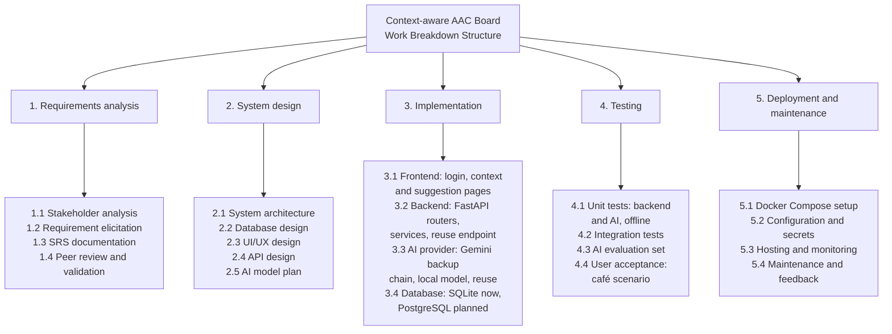
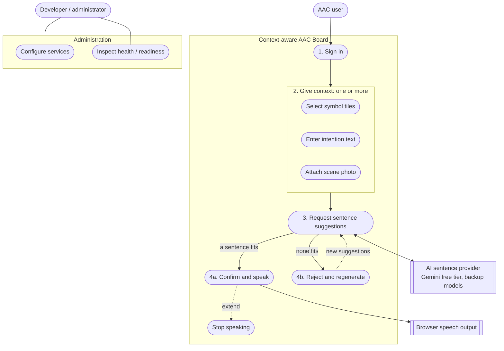
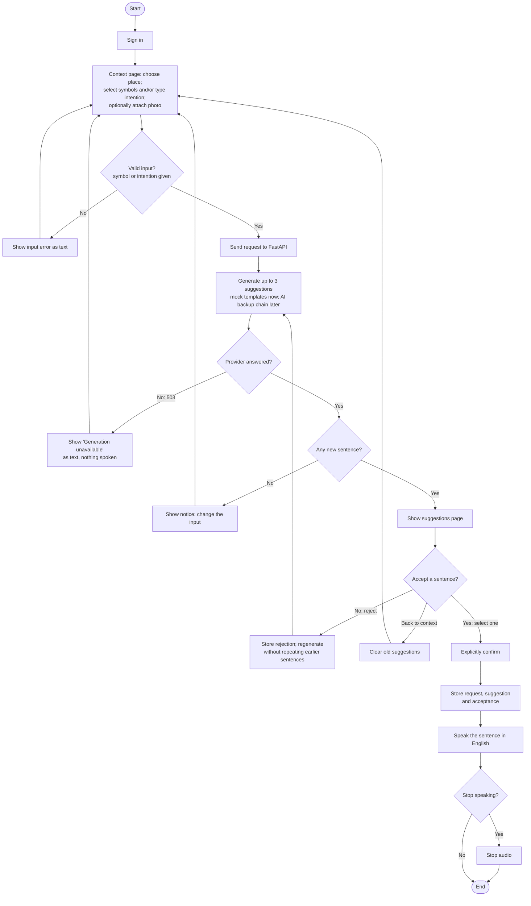
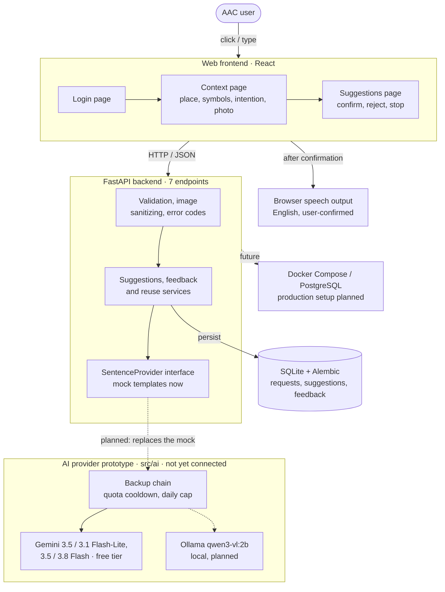

# Software Requirements Specification

## Context-aware AAC Board

**B — The Outliers** · A context-aware communication assistant for everyday requests

*Table 1. Project information*

| Document control | Value |
| --- | --- |
| Team | B – The Outliers |
| Authors | Veronika Surianinova · Jiahui Chen · Thibaut de Robien · Abid Ali |
| Course / institution | Software Engineering · Beihang University |
| Document edition | v0.4 (Markdown edition of review draft v0.3) |
| Date | 29 October 2026 |
| Scope | Web-first prototype · English only · café scenario first |
| Baseline | IEEE-inspired SRS template supplied by professor |

## Table of Contents

- [Chapter 1 — Introduction](#chapter-1--introduction)
  - [1.1 Document Purpose](#11-document-purpose)
  - [1.2 Product Scope](#12-product-scope)
  - [1.3 Definitions, Acronyms, and Abbreviations](#13-definitions-acronyms-and-abbreviations)
  - [1.4 References](#14-references)
  - [1.5 Document Overview](#15-document-overview)
- [Chapter 2 — Product Overview](#chapter-2--product-overview)
  - [2.1 Product Perspective](#21-product-perspective)
  - [2.2 Product Functions](#22-product-functions)
  - [2.3 Product Constraints](#23-product-constraints)
  - [2.4 User Characteristics](#24-user-characteristics)
  - [2.5 Assumptions and Dependencies](#25-assumptions-and-dependencies)
  - [2.6 Apportioning of Requirements](#26-apportioning-of-requirements)
- [Chapter 3 — Software Requirements](#chapter-3--software-requirements)
  - [3.1 External Interfaces](#31-external-interfaces)
  - [3.2 Functional](#32-functional)
  - [3.3 Quality of Service](#33-quality-of-service)
  - [3.4 Compliance](#34-compliance)
  - [3.5 Design and Implementation](#35-design-and-implementation)
  - [3.6 AI/ML](#36-aiml)
- [Chapter 4 — Verification](#chapter-4--verification)
- [Chapter 5 — Appendixes](#chapter-5--appendixes)
  - [Appendix A — Primary acceptance scenario](#appendix-a--primary-acceptance-scenario)
  - [Appendix B — Open decisions to close before professor submission](#appendix-b--open-decisions-to-close-before-professor-submission)
  - [Appendix C — Frontend progress screenshots](#appendix-c--frontend-progress-screenshots)
  - [Appendix D — Architecture and records](#appendix-d--architecture-and-records)
  - [Appendix E — Verified team contributions and development evidence](#appendix-e--verified-team-contributions-and-development-evidence)
  - [Appendix F — Scholarly literature and technical reference list](#appendix-f--scholarly-literature-and-technical-reference-list)
  - [Appendix G — Sources and limitations](#appendix-g--sources-and-limitations)

## List of Figures

- Figure 1. Work Breakdown Structure (WBS)
- Figure 2. System use case diagram
- Figure 3. AAC request activity diagram
- Figure 4. Logical system architecture
- Figure 5. Login page — branding, email/password input and account entry
- Figure 6. Context page — café context, symbol tiles, optional photo and intention text
- Figure 7. Suggestions page — three sentence choices and confirm/reject/stop controls

*Table 2. Document sections*

| Section | Contents |
| --- | --- |
| 1 | Introduction and terminology |
| 2 | Product overview, actors, scope, constraints and increments |
| 3 | External interfaces; 45 requirement identifiers across functional, quality, compliance, design and AI/ML |
| 4 | Verification approach, traceability and current progress |
| 5 | Appendixes: end-to-end scenario, diagrams, frontend screenshots and outstanding decisions |

## Revision History

*Table 3. Revision history*

| Version | Date | Change |
| --- | --- | --- |
| 0.1 | 13 Oct 2026 | Initial team draft grounded in proposal/backend starter |
| 0.2 | 13 Oct 2026 | Standalone application; Cboard is inspiration only |
| 0.3 review draft | 27 Oct 2026 | Presentation-ready layout; screenshots and current update incorporated; verification pending team review |
| 0.4 | 29 Oct 2026 | Markdown edition of v0.3 with the same structure and requirements. Figures 1–4 redrawn in Mermaid to match the real workflow (sign in → context → suggestions → confirm and speak or reject and regenerate). AI-related text (2.1, 3.6, REQ-INT-005, REQ-ML-001 … 006, AI evidence) corrected against the implementation. A specific rationale written for every requirement |

## Chapter 1 — Introduction

This SRS provides the agreed documentation baseline for Team B — The Outliers: Veronika, Jiahui, Thibaut and Abid Ali. The Context-aware AAC Board is intended to help people with speech or language impairments communicate everyday requests by selecting meaningful symbols, giving context and choosing a complete English sentence. The document describes intended behavior, not a claim that every proposed feature has already been completed. The Context-aware AAC Board is a standalone English-language web application intended to support people with speech or language impairments in expressing everyday requests. User-selected symbols or text communicate intent; optional scene information helps produce appropriate sentence options. The user retains control over what is spoken.

### 1.1 Document Purpose

This specification is written for the professor, project developers, reviewers and testers. It explains what functions and quality attributes the product must provide, sets boundaries for implementation, and connects uniquely numbered requirements to measurable acceptance checks. Readers should use it to review scope, manage changes and decide whether evidence from testing or demonstration meets each requirement. Define the expected external behaviors, quality attributes, interfaces, constraints, and acceptance criteria. Intended readers are the four team members, course instructor, peer reviewers, testers, and future maintainers. This document separates verified prototype behavior from future AI, deployment, authentication and accessibility work.

### 1.2 Product Scope

The initial web application supports an English-language café use case: users select a scene and pictorial item, optionally add an intention and photo, receive up to three sentence options, then choose and explicitly confirm what is spoken. Rejection and regeneration are part of the planned workflow. The team's reported starter supports mock templates rather than genuine photo understanding; wider contexts, live AI and mobile support must not be treated as already delivered. The initial release demonstrates a café request from context selection to at most three English suggestions, choice, explicit confirmation and speech. Inputs include symbols, free-text intent, scene hint and optional photo. Requests, suggestions and feedback are recorded. Additionally, a mobile app, and public production deployment are not included in the first demonstrated increment.

*Table 4. 1.2 Product Scope*

| In scope | Excluded or deferred |
| --- | --- |
| Standalone web frontend and API | Cboard fork or reuse of Cboard code/assets |
| English symbol/text and scene context; optional photo | Multilingual interface/speech |
| Up to three suggested English sentences | Autonomous speech without confirmation |
| Selection, acceptance, rejection, regeneration | Public user study without privacy and consent readiness |
| Initial café scenario; evaluation and feedback | Mobile packaging and semantic caching unless prioritized |

### 1.3 Definitions, Acronyms, and Abbreviations

AAC denotes Augmentative and Alternative Communication, including tools that supplement or replace speech. A symbol tile is a selectable pictogram representing an item or action; a scene hint identifies the setting; intent text specifies what the user wants to communicate. The sentence provider is the replaceable component that returns candidate English phrases, whether it uses fixed templates or a language model. Verification evidence is a dated test record, inspection or demonstration supporting a requirement result.

*Table 5. 1.3 Definitions, Acronyms, and Abbreviations*

| Term | Meaning |
| --- | --- |
| AAC | Augmentative and Alternative Communication |
| API | Application Programming Interface |
| Backup chain | Ordered list of AI models; when one cannot answer (quota, error or timeout) the next one is used |
| Cboard | An existing AAC product serving as design inspiration only |
| CI | Continuous Integration |
| EXIF | Image metadata that may include device or location information |
| Free tier | No-cost use of a hosted AI service, limited in requests per minute and per day for each model |
| LLM | Large Language Model |
| Mock provider | Rule/template-based generator, not a real AI model |
| SRS | Software Requirements Specification |
| TTS | Text-to-Speech |
| VLM | Vision-Language Model |

### 1.4 References

GitHub IEEE-style SRS template determines this document's main organization. Internal source material consists of the original team presentation, the weekly report and the supplied interface screenshots. The earlier presentation proposed extending Cboard, while the newer weekly update defines a standalone system with Cboard only as design inspiration. The latest recorded scope is therefore used, and unresolved implementation choices remain identified as pending decisions.

*Table 6. 1.4 References*

| Ref | Document / source |
| --- | --- |
| R1 | Professor template: https://github.com/ovikrai/SRS-Template-IEEE |
| R2 | Team SRS v0.2: https://github.com/bhsei/26B/blob/main/docs/requirements/SRS.md (Git history) |
| R3 | Team presentation script, supplied PDF (proposal-level background) |
| R4 | Weekly Progress Report supplied PPTX (current scope, task allocation and progress) |
| R5 | Frontend screenshots supplied 27 Oct 2026 (login, context board, suggestion selection) |
| R6 | Companion team files: [docs/API.md](../API.md); [docs/VERIFICATION.md](../VERIFICATION.md); [docs/TEAM_NEXT_STEPS.md](../TEAM_NEXT_STEPS.md) |
| R7 | AI model plan: [docs/design/AI_Model_Plan.md](../design/AI_Model_Plan.md) (model choice, hardware limits, failure handling) |
| R8 | AI prototype and measured free-tier limits: [src/ai/README.md](../../src/ai/README.md) |

Academic research added to the bibliography in Appendix F includes Pereira et al. (2024) on Transformers for predictive AAC, Valencia et al. (2023) on AAC users' preferences and agency when using AI suggestions, and Pak et al. (2023) on speech-generating AAC interventions. The SRS draws on these for requirements justification; they are not validation results for the current prototype.

### 1.5 Document Overview

Section 2 introduces product context, expected users, main functions and project constraints.

Section 3 specifies external interfaces, functional behavior, quality of service, compliance, design and implementation, and AI/ML obligations.

Section 4 defines verification methods and traceability.

Section 5 holds example scenarios, illustrations and decisions awaiting team approval; these appendixes supplement but do not replace numbered requirements.

## Chapter 2 — Product Overview

The intended product is a browser-based assistive communication tool rather than a general chatbot. It combines a small number of explicit selections with contextual phrasing so a user can express a request with less typing. Respecting the user's intention is fundamental: photographs or model outputs cannot independently authorize speech or introduce a request the person did not choose.

### 2.1 Product Perspective

The updated solution is a standalone React frontend communicating with a FastAPI backend over HTTP/JSON. The backend validates input, calls a replaceable sentence provider and maintains records for requests, suggestions and feedback. SQLite is the reported tested database in the backend starter; PostgreSQL is a planned deployment option requiring verification. Browser speech output belongs to the interaction path and must follow explicit user confirmation. A browser-based client sends validated HTTP/JSON requests to a FastAPI backend. The backend stores metadata and feedback in a relational database and delegates sentence generation to a replaceable provider interface. The backend currently uses mock sentence templates. The real provider exists as a tested prototype (`src/ai/`): one multimodal call to a hosted Gemini model on the free tier, with a backup chain of further Gemini models and a planned local model; it is not yet connected to the backend. The browser/device supplies English speech output. The application is standalone, not a Cboard extension.

*Table 7. 2.1 Product Perspective*

| Component | Responsibility / status |
| --- | --- |
| User and browser | Select context symbols/text; upload optional photo; review and speak |
| Frontend: React / JavaScript | New team UI; screenshots show login, context tile board and suggestion selection |
| Backend: Python / FastAPI | Input validation, generation orchestration, feedback endpoints |
| Sentence Provider | Mock in the backend; real provider prototyped in `src/ai/` (Gemini Flash-Lite and Flash backup chain on the free tier, local Ollama model planned), evaluation pending |
| Storage | SQLite in local starter; PostgreSQL server target not yet verified |
| Speech | Browser speech output planned / manual device verification outstanding |
| Deployment | Docker Compose and public security controls pending |

### 2.2 Product Functions

The main user journey begins with a scene such as a café, a chosen symbol such as Water and optional typed intentions or a photo. The system checks submitted data and presents a short set of English sentence options. The user can accept, reject, retry or go back to change context. Request identity, feedback storage and readiness checks support integration and evaluation. Login, live model inference and broader situation coverage require independent implementation and testing. The user can enter scene context, choose AAC symbol tiles, supply short intent text, optionally upload a photo, request up to three complete English suggestions, choose or reject a suggestion, explicitly confirm speech, stop audio, and receive clear status/error feedback. The backend records requests, suggestions and feedback while minimizing retained image data. Authentication is depicted in updated screenshots, but secure account ownership must be verified separately.

### 2.3 Product Constraints

The first release is English-only, web-first and focused on a café demonstration; mobile adaptation is optional. Interfaces should emphasize legible text, understandable symbols and predictable controls suitable for people with differing communication and motor needs. The team must work within course milestones, licensing rules and practical hosting costs. Model, deployment and authentication details have not all been finalized, so they must be settled through change control before release. Initial English-only interface/output; web-first delivery; café-first test scenario; no copying of Cboard assets; explicit user confirmation before sound; user intent must never be inferred from image alone; zero AI budget, so only free tiers of hosted models are used, and the development laptop (7.3 GB RAM, no CUDA GPU) cannot run local models above about 2 B parameters; avoid using real sensitive photos or users until consent, security and retention safeguards are approved.

*Figure 1. Work Breakdown Structure (WBS).*

### 2.4 User Characteristics

The main users may have difficulty speaking or composing long English phrases, so they need an interface where a few deliberate inputs can lead to a usable sentence. Some users may prefer symbols and others short text, and not every device will provide a camera. Caregivers or educators may assist during evaluation, while developers administer backend operations. Actual accessibility and usability with representative AAC users have not yet been established by the supplied screenshots.

*Table 8. 2.4 User Characteristics*

| User group | Characteristics / needs |
| --- | --- |
| Primary AAC user | May have speech/language impairment, benefits from large selectable pictograms, plain language, predictable navigation, speech confirmation |
| Support person/caregiver | May help configure or demonstrate the system; no unapproved impersonation |
| Team tester | Runs café scenario and records performance, relevance, safety and usability feedback |
| System operator | Configures services, deployment, database, logging and secrets |

### 2.5 Assumptions and Dependencies

The core workflow assumes a functioning browser; audible speech additionally depends on an accessible English voice and suitable device speakers. Photo input must remain optional. The quality, cost and latency of live contextual sentences will depend on the final AI provider, whereas the reported backend checkpoint uses fixed mock suggestions. Hosting, secrets, cross-platform support, database migration and data consent require further decisions and verified configuration. A device supports browser access and may provide a usable English voice; photos are optional and not sufficient alone to determine user intent; synthetic data can be used in development; the selected generation provider is reachable within available budget; free-tier limits and model names can change without notice, and free-tier inputs may be used by the provider to improve its products; third-party dependencies remain installable; frontend/backend can be integrated during the course schedule. A failed assumption must trigger fallback handling or a change request.

### 2.6 Apportioning of Requirements

The team prioritizes an end-to-end café scenario before extending the symbol vocabulary to other contexts. Thibaut leads frontend and symbol interaction, Veronika leads backend and data integration, Jiahui leads model selection and evaluation, and Abid Ali leads deployment, authentication and limits, as recorded in the weekly report. Public access requires deployment security and rate controls; work with real users additionally requires consent, data-retention and licence review. The group shares integration testing and documentation review.

*Figure 2. System use case diagram. The AAC user signs in, gives context with symbols, text or a photo, requests suggestions, and then confirms and speaks one sentence or rejects them and regenerates.*

*Table 9. 2.6 Apportioning of Requirements*

| Owner | Responsibility | Near-term deliverable |
| --- | --- | --- |
| Thibaut | Symbol board, accessible frontend and cross-page navigation | Water tile → suggestion-selection flow |
| Veronika | Backend/API, relational storage, frontend integration | Working provider API, errors, database checks |
| Jiahui | AI/provider selection, prompts and evaluation | Connect the tested backup chain to the backend; evaluated café outputs |
| Abid Ali | CI/deployment/security/operations | Compose deployment, PostgreSQL migration, auth and rate-limit plan |
| All | SRS validation, human evaluation, consent, licenses | Cross-review and repeatable acceptance demo |

## Chapter 3 — Software Requirements

Each requirement below defines an outcome that should be observable, inspectable or measurable. Existing requirement IDs and verification references are retained so the revised prose does not invalidate the team's traceability. Suggested performance or service targets that have not been approved should be recorded as open decisions, not represented as tested results. The entries below retain the established 45-requirement classification and stable IDs described in the team progress materials. "To verify" means this formatted draft does not independently claim a live test result. Implementation remarks are based on the team progress presentation (baseline week 6), not fresh execution. All quantitative TBD values require group approval before final acceptance.

### 3.1 External Interfaces

Interfaces specify how users, hardware and connected services exchange information. Inputs must be validated and outputs must communicate state clearly, including unsupported devices, provider failures and invalid requests. Separating UI, hardware and software contracts allows independent component tests followed by end-to-end browser demonstrations.

#### 3.1.1 User Interfaces

The supplied screens illustrate a welcome/login design, a context screen with café selection and pictogram tiles, and a suggestion screen with candidate sentences and confirm/reject/stop actions. The experience must support revising the selected context without retaining stale suggestions, readable feedback and user confirmation before speech. The pictures show frontend work but do not establish that sign-in, AI image analysis or audio output have passed functional testing.

**REQ-INT-001 | English communication flow**

*Table 10. Specification and acceptance criteria — REQ-INT-001*

| Field | Specification |
| --- | --- |
| Statement | The UI shall support entering context, viewing up to three English suggestions, selecting one, confirming/speaking, rejecting/regenerating and stopping speech. |
| Rationale | AAC users need a short, predictable path from context to a spoken sentence. Every control must work with pointer and keyboard because motor abilities differ, and confirmation before speech keeps the user in control. |
| Acceptance criteria | Three stages and all controls can be completed from keyboard/pointer; confirmation disabled before selection. |
| Verification method | Demonstration |
| Evidence/status | Frontend pictured; end-to-end verification pending — confirm against current test log and running frontend. |
| Owner | Thibaut |

**REQ-INT-002 | Text-only status and errors**

*Table 11. Specification and acceptance criteria — REQ-INT-002*

| Field | Specification |
| --- | --- |
| Statement | The UI shall display validation, generation and service messages as text and shall never speak these messages. |
| Rationale | A spoken error or status message would be heard by the listener as if the user had said it. Only a sentence the user selected and confirmed may be voiced. |
| Acceptance criteria | Simulated backend errors appear visibly with zero speech output. |
| Verification method | Demonstration |
| Evidence/status | Demo page implemented; team UI check pending — confirm against current test log and running frontend. |
| Owner | Thibaut |

#### 3.1.2 Hardware Interfaces

The application is intended for ordinary web-capable devices with a display and pointer or touch input. Camera and photo-gallery access are optional input methods, and audio hardware supports audible sentence output. The interface should remain usable if a camera or speaker is unavailable, with an appropriate visible explanation rather than an unexplained failure. Physical-device and browser permission checks must be documented for each tested environment.

**REQ-INT-003 | Optional photo and English audio**

*Table 12. Specification and acceptance criteria — REQ-INT-003*

| Field | Specification |
| --- | --- |
| Statement | The system shall accept supported browser photo/file inputs and shall produce speech only after confirmation using an available English voice. |
| Rationale | A photo adds context but many users or devices have no camera, so it must stay optional. Speech is the product's output, so it must use an English voice and start only after confirmation. |
| Acceptance criteria | JPEG/PNG/WebP selectable; no audio before confirmation; graceful voice-unavailable notice. |
| Verification method | Demonstration |
| Evidence/status | Audio not independently verified — confirm against current test log and running frontend. |
| Owner | Thibaut |

#### 3.1.3 Software Interfaces

The React client sends structured requests to the FastAPI service, which is responsible for validation, suggestions, feedback and service health. A stable sentence-provider abstraction permits switching from a deterministic mock to a live AI model without changing the user journey. Database migrations support consistent storage. Any selected external API must have recorded request/response formats, authentication, timeouts, error mapping and data-sharing rules.

**REQ-INT-004 | REST API**

*Table 13. Specification and acceptance criteria — REQ-INT-004*

| Field | Specification |
| --- | --- |
| Statement | The server shall expose POST /api/suggestions, POST /api/suggestions/image, PUT /api/requests/{request_id}/feedback, GET /health, GET /ready and /openapi.json. |
| Rationale | A fixed, documented contract lets the frontend and backend be built and tested separately and lets reviewers check the behaviour against it. |
| Acceptance criteria | Endpoints conform to docs/API.md with documented success/error responses. |
| Verification method | Test |
| Evidence/status | Backend v0.1 reported implemented — confirm against current test log and running frontend. |
| Owner | Veronika |

**REQ-INT-005 | Replaceable provider**

*Table 14. Specification and acceptance criteria — REQ-INT-005*

| Field | Specification |
| --- | --- |
| Statement | The backend shall use a SentenceProvider abstraction accepting validated inputs, sanitized optional image bytes and excluded suggestions; response shall include sentences and an image_analyzed flag. |
| Rationale | The model is still being chosen and free-tier offers change often. A stable interface lets the team replace the mock or switch models without changing the API or the user journey, and lets tests inject a fake provider. |
| Acceptance criteria | Mock/test provider can be swapped without changing API contract. |
| Verification method | Test |
| Evidence/status | Mock implemented in the backend. The real adapters (Gemini, local Ollama, OpenAI-compatible) implement the same inputs and outputs in the `src/ai/` prototype with offline tests, but are not yet registered in the backend (`AI_PROVIDER` accepts only `mock`). |
| Owner | Jiahui |

*Figure 3. AAC request activity diagram.*

**REQ-INT-006 | Symbol tile mapping**

*Table 15. Specification and acceptance criteria — REQ-INT-006*

| Field | Specification |
| --- | --- |
| Statement | The UI shall map chosen image tiles to stable, unambiguous text labels sent as symbols to the backend. |
| Rationale | The backend, the stored records and the reuse of accepted sentences match requests by these labels. Ambiguous or changing labels would produce wrong sentences or miss earlier choices. |
| Acceptance criteria | Selecting Water sends the agreed water symbol label and updates active-tile indication. |
| Verification method | Demonstration |
| Evidence/status | Screenshot shows tiles; API mapping test pending — confirm against current test log and running frontend. |
| Owner | Thibaut |

### 3.2 Functional

Functional requirements describe externally visible steps: entering meaningful context; selecting a symbol; validating images and text; receiving a bounded set of appropriate alternatives; recording accepted or rejected suggestions; avoiding repeated rejected options; and speaking only after selecting and confirming a sentence. Tests must include unusual inputs, changes of context, failed providers and repeat clicks. An automated backend pass does not alone establish the same behavior in the real frontend.

**REQ-FUNC-001 | Input validation**

*Table 16. Specification and acceptance criteria — REQ-FUNC-001*

| Field | Specification |
| --- | --- |
| Statement | The API shall validate allowed symbol labels, intent text, scene hint and English language field. |
| Rationale | Unchecked symbols and text could overload the provider, fill the database or carry instructions aimed at the model. Validation also gives the user a clear, early error. |
| Acceptance criteria | Invalid types or excessive inputs are rejected with safe 422 details. |
| Verification method | Test |
| Evidence/status | Starter validated — confirm against current test log and running frontend. |
| Owner | Veronika |

**REQ-FUNC-002 | Image validation**

*Table 17. Specification and acceptance criteria — REQ-FUNC-002*

| Field | Specification |
| --- | --- |
| Statement | The API shall validate file format, file size and decodability before using images. |
| Rationale | Uploaded files can be huge, malformed or crafted as decompression bombs. Checking format, size and decodability protects the server before any image processing. |
| Acceptance criteria | Unsupported, oversize and corrupt images receive documented errors. |
| Verification method | Test |
| Evidence/status | Starter validated — confirm against current test log and running frontend. |
| Owner | Veronika |

**REQ-FUNC-003 | Generate options**

*Table 18. Specification and acceptance criteria — REQ-FUNC-003*

| Field | Specification |
| --- | --- |
| Statement | The system shall produce no more than three complete English sentence suggestions from the provided input. |
| Rationale | Three complete sentences give a real choice without a long list to read, which matters for users with reading or motor difficulties. |
| Acceptance criteria | Café water scenario produces 1–3 user-readable options. |
| Verification method | Test |
| Evidence/status | Starter validated — confirm against current test log and running frontend. |
| Owner | Veronika |

**REQ-FUNC-004 | Stable request identity**

*Table 19. Specification and acceptance criteria — REQ-FUNC-004*

| Field | Specification |
| --- | --- |
| Statement | Each successful request shall return an identifier enabling downstream feedback and regeneration. |
| Rationale | Feedback and regeneration must refer to exactly the sentences the user saw. Without a stable identifier a choice could be stored against the wrong request. |
| Acceptance criteria | The ID resolves the correct request and suggestions. |
| Verification method | Test |
| Evidence/status | Starter validated — confirm against current test log and running frontend. |
| Owner | Veronika |

**REQ-FUNC-005 | Accept a suggestion**

*Table 20. Specification and acceptance criteria — REQ-FUNC-005*

| Field | Specification |
| --- | --- |
| Statement | The system shall persist acceptance only for a suggestion belonging to the indicated request. |
| Rationale | Storing a choice for a sentence that belongs to another request would record something the user never saw and corrupt the evaluation data and the reuse history. |
| Acceptance criteria | Valid acceptance succeeds; mismatched or unknown IDs fail. |
| Verification method | Test |
| Evidence/status | Starter validated — confirm against current test log and running frontend. |
| Owner | Veronika |

**REQ-FUNC-006 | Reject and regenerate**

*Table 21. Specification and acceptance criteria — REQ-FUNC-006*

| Field | Specification |
| --- | --- |
| Statement | The user shall reject options and regenerate without repeating earlier sentences in the same unchanged-input chain. |
| Rationale | Seeing a rejected sentence again wastes the user's effort. Allowing changed inputs inside a chain would mix two different wishes. |
| Acceptance criteria | Prior strings are excluded; changed chained inputs are rejected. |
| Verification method | Test |
| Evidence/status | Starter validated — confirm against current test log and running frontend. |
| Owner | Veronika |

**REQ-FUNC-007 | User-confirmed speech**

*Table 22. Specification and acceptance criteria — REQ-FUNC-007*

| Field | Specification |
| --- | --- |
| Statement | The frontend shall speak only after the chosen sentence is explicitly confirmed; stopping speech shall be possible. |
| Rationale | The sentence is spoken in the user's name. Speaking before confirmation could say something the user never chose, and a stop control limits the harm of a wrong choice. |
| Acceptance criteria | Loading/options alone produce no sound; stop button interrupts playback. |
| Verification method | Demonstration |
| Evidence/status | Frontend/pending phase — confirm against current test log and running frontend. |
| Owner | Thibaut / team |

**REQ-FUNC-008 | Clear stale options**

*Table 23. Specification and acceptance criteria — REQ-FUNC-008*

| Field | Specification |
| --- | --- |
| Statement | The UI shall invalidate previous suggestions when any context input changes. |
| Rationale | If old suggestions stay after the place, tile, text or photo changes, the user could confirm a sentence that belongs to the previous situation. |
| Acceptance criteria | Changing location, selected tile, text or photo clears previous selection. |
| Verification method | Demonstration |
| Evidence/status | Frontend/pending phase — confirm against current test log and running frontend. |
| Owner | Thibaut / team |

*Figure 4. Logical system architecture.*

**REQ-FUNC-009 | Persist activity metadata**

*Table 24. Specification and acceptance criteria — REQ-FUNC-009*

| Field | Specification |
| --- | --- |
| Statement | The backend shall store generation inputs, suggestions, provider/latency, link to previous request and feedback, but not raw photos. |
| Rationale | Inputs, outputs, latency and decisions are needed to evaluate quality and to support regeneration and reuse. Raw photos are not needed and would add privacy risk. |
| Acceptance criteria | Data survives restart; feedback updates without duplicate records. |
| Verification method | Test |
| Evidence/status | Starter validated — confirm against current test log and running frontend. |
| Owner | Veronika |

**REQ-FUNC-010 | Integrated web flow**

*Table 25. Specification and acceptance criteria — REQ-FUNC-010*

| Field | Specification |
| --- | --- |
| Statement | The team web frontend shall complete the context → suggestions → choose → confirm/speak workflow via the actual backend. |
| Rationale | Backend tests and the demo page do not prove that the team's own interface works; the course product is the integrated web application. |
| Acceptance criteria | One repeatable café scenario passes from tile selection to saved acceptance. |
| Verification method | Demonstration |
| Evidence/status | Frontend/pending phase — confirm against current test log and running frontend. |
| Owner | Thibaut / team |

**REQ-FUNC-011 | Additional contexts**

*Table 26. Specification and acceptance criteria — REQ-FUNC-011*

| Field | Specification |
| --- | --- |
| Statement | After the café increment the product should support further approved everyday situations, e.g. bus or medical visit. |
| Rationale | AAC users communicate in many places. A single café scenario would not show that the approach works beyond one vocabulary. |
| Acceptance criteria | Team agrees scenario set and demonstrates at least one additional case. |
| Verification method | Demonstration |
| Evidence/status | Frontend/pending phase — confirm against current test log and running frontend. |
| Owner | Thibaut / team |

### 3.3 Quality of Service

The application must not merely generate plausible language; it must do so promptly, consistently, securely and with enough diagnostic information for maintenance. Quality claims should be supported with measured latency, fault-handling trials, security inspection and operational records in clearly identified environments. Numerical targets that are still open must be agreed before final acceptance.

#### 3.3.1 Performance

Sentence suggestions need to arrive quickly enough for an ordinary real-time interaction. Measurements should separate interface delay, request validation, model computation and start of speech playback. Because a mock template provider may be much faster than a real vision-language service, the team must report provider version, test hardware and the percentile measured alongside any response-time result. The final performance threshold remains subject to agreement.

**REQ-PERF-001 | Generation latency**

*Table 27. Specification and acceptance criteria — REQ-PERF-001*

| Field | Specification |
| --- | --- |
| Statement | The server shall record provider latency per generation; a maximum user-facing response time under defined load shall be set before final release. |
| Rationale | A listener will not wait long for a reply. Hosted models are much slower than the mock (1.4–26 s measured on the free tier), so latency must be measured before a target can be agreed. |
| Acceptance criteria | Latency value present; numerical threshold and load profile remain TBD. |
| Verification method | Analysis |
| Evidence/status | Latency logging reported; target TBD. AI measurements on synthetic inputs: Gemini 3.5 Flash 1.4–26 s per request (21 Oct 2026); full generations with 3.5 and 3.1 Flash-Lite 1.7–6.2 s (28 Oct 2026). |
| Owner | Veronika |

#### 3.3.2 Security

Security is especially important because users may enter personal intentions or upload scene photographs. Uploaded files should be checked and minimized, sensitive metadata should not be unnecessarily retained, and credentials or API secrets must remain outside browser code. Any public multi-user version needs authenticated ownership checks, request limits and clear consent and retention rules. The provided login mockup must not be taken as evidence that secure authentication is already implemented.

**REQ-SEC-001 | Photo minimization**

*Table 28. Specification and acceptance criteria — REQ-SEC-001*

| Field | Specification |
| --- | --- |
| Statement | The system shall decode, resize to at most 1024×1024, and re-encode submitted photos without EXIF metadata; raw originals shall not be stored. |
| Rationale | Scene photos can show faces, homes or GPS metadata. Minimising them and never storing the originals limits the harm of a data leak. |
| Acceptance criteria | DB has no raw photo; output re-encoded JPEG has no EXIF. |
| Verification method | Test / Inspection |
| Evidence/status | Implemented in starter — confirm against current test log and running frontend. |
| Owner | Abid / Veronika |

**REQ-SEC-002 | Safe error responses**

*Table 29. Specification and acceptance criteria — REQ-SEC-002*

| Field | Specification |
| --- | --- |
| Statement | API shall not expose provider stack traces, secrets or internal exception content to users. |
| Rationale | Stack traces and provider messages can reveal keys, paths or internal structure to an attacker and mean nothing to the user. |
| Acceptance criteria | Failures return safe generic error responses. |
| Verification method | Test / Inspection |
| Evidence/status | Implemented in starter — confirm against current test log and running frontend. |
| Owner | Abid / Veronika |

**REQ-SEC-003 | Secrets configuration**

*Table 30. Specification and acceptance criteria — REQ-SEC-003*

| Field | Specification |
| --- | --- |
| Statement | Service credentials shall come from environment/secret configuration and never be committed to public source. |
| Rationale | The repository is public. A committed API key would be copied at once and could use up the free quota or create costs. |
| Acceptance criteria | Repository inspection confirms no exposed keys. |
| Verification method | Test / Inspection |
| Evidence/status | Implemented in starter — confirm against current test log and running frontend. |
| Owner | Abid / Veronika |

**REQ-SEC-004 | Input and output safety**

*Table 31. Specification and acceptance criteria — REQ-SEC-004*

| Field | Specification |
| --- | --- |
| Statement | The backend shall validate input and the frontend shall escape generated text when displaying it. |
| Rationale | Model output is untrusted text. Rendering it as HTML could run injected scripts in the user's browser. |
| Acceptance criteria | Injected HTML is displayed as text and cannot execute. |
| Verification method | Test / Inspection |
| Evidence/status | Implemented in starter — confirm against current test log and running frontend. |
| Owner | Abid / Veronika |

**REQ-SEC-005 | Authentication and ownership**

*Table 32. Specification and acceptance criteria — REQ-SEC-005*

| Field | Specification |
| --- | --- |
| Statement | Prior to public trial, all user-owned records and endpoints shall enforce authenticated access and ownership. |
| Rationale | Request IDs are not authorization. Personal requests and accepted sentences must not be readable or changeable by other users, especially once they are reused. |
| Acceptance criteria | Cross-account read/write tests are denied. |
| Verification method | Test / Inspection |
| Evidence/status | Not production-ready — confirm against current test log and running frontend. |
| Owner | Abid / Veronika |

**REQ-SEC-006 | Abuse and budget limits**

*Table 33. Specification and acceptance criteria — REQ-SEC-006*

| Field | Specification |
| --- | --- |
| Statement | Public endpoints shall use approved rate limits, request/image limits and provider-spend safeguards. |
| Rationale | An open endpoint can be flooded, and every model call uses a scarce free quota (as low as 20 requests per day per model) or money on a paid tier. |
| Acceptance criteria | Load/abuse tests verify safe limits; thresholds TBD. |
| Verification method | Test / Inspection |
| Evidence/status | Not production-ready. AI quota safeguards in the prototype: local cap of 16 calls per model per day, no retry on HTTP 429, cooldown until the quota resets. |
| Owner | Abid / Veronika |

**REQ-SEC-007 | Consent and retention**

*Table 34. Specification and acceptance criteria — REQ-SEC-007*

| Field | Specification |
| --- | --- |
| Statement | Before testing with real users, the application shall present informed consent and implement a reviewed retention/deletion policy. |
| Rationale | AAC users may be in a vulnerable position, and free-tier AI services may use inputs to improve their products. Consent and retention rules must exist before any real personal data is used. |
| Acceptance criteria | Written policy, consent record and erasure test available. |
| Verification method | Test / Inspection |
| Evidence/status | Not production-ready — confirm against current test log and running frontend. |
| Owner | Abid / Veronika |

#### 3.3.3 Reliability

A communication request must behave predictably during invalid input, provider timeout, network interruption or repeated button presses. Error messages should allow the person to retry or revise a request without unintentionally speaking an old sentence. Feedback processing should avoid accidental duplicate records, and the system must never treat a failed generation as a confirmed user choice. Failure injection and retry tests should document these properties.

**REQ-REL-001 | Generation error mapping**

*Table 35. Specification and acceptance criteria — REQ-REL-001*

| Field | Specification |
| --- | --- |
| Statement | The system shall handle invalid or failing provider output with a controlled response rather than crash. |
| Rationale | A model can return malformed, overlong, empty or duplicated output. Showing or storing it unchecked would break the interface or the records. |
| Acceptance criteria | Provider error yields documented controlled status. |
| Verification method | Test |
| Evidence/status | Starter partially/fully supported; live provider pending — confirm against current test log and running frontend. |
| Owner | Veronika |

**REQ-REL-002 | Unavailable provider**

*Table 36. Specification and acceptance criteria — REQ-REL-002*

| Field | Specification |
| --- | --- |
| Statement | The system shall return a controlled 503 when provider is unavailable and enforce configured network timeout for real services. |
| Rationale | Hosted models can be overloaded (HTTP 503) or hang. Without a timeout the user waits indefinitely; a clear 503 lets the frontend offer a retry instead of failing silently. |
| Acceptance criteria | ProviderUnavailable maps to 503; timeout target TBD. |
| Verification method | Test |
| Evidence/status | 503 mapping implemented in the backend. Prototype timeouts: hosted models 15 s connect and 30 s read, local model 3 s connect and 180 s read; no new attempt after the total time budget. |
| Owner | Veronika |

**REQ-REL-003 | Idempotent feedback**

*Table 37. Specification and acceptance criteria — REQ-REL-003*

| Field | Specification |
| --- | --- |
| Statement | Repeated identical feedback submissions shall not create duplicate feedback rows. |
| Rationale | Double clicks and network retries are common on touch devices. Duplicate feedback rows would distort the evaluation and the reuse history. |
| Acceptance criteria | Two equivalent updates produce exactly one current record. |
| Verification method | Test |
| Evidence/status | Starter partially/fully supported; live provider pending — confirm against current test log and running frontend. |
| Owner | Veronika |

#### 3.3.4 Availability

Service readiness means the application and its dependencies are reachable when needed. The backend starter includes health and readiness endpoints, but those checks do not establish an operational uptime guarantee. A service-level objective requires an approved hosting environment, monitoring period, defined outage criteria and recovery plan. Until these decisions are made and measured, any numerical availability claim should remain pending.

**REQ-AVAIL-001 | Health and readiness**

*Table 38. Specification and acceptance criteria — REQ-AVAIL-001*

| Field | Specification |
| --- | --- |
| Statement | The backend shall expose a liveness check and a readiness check covering database reachability/migrations; a target service availability is TBD. |
| Rationale | Deployment and demonstrations need an automatic signal that the service and its database are really ready before users arrive. |
| Acceptance criteria | Ready becomes not-ready when schema is absent and ready after migration. |
| Verification method | Test |
| Evidence/status | Endpoints reported working; SLA TBD — confirm against current test log and running frontend. |
| Owner | Abid |

#### 3.3.5 Observability

Logs, test outputs and metrics should make it possible to investigate validation errors, unavailable model providers, latency and service readiness. Diagnostic records should use stable request identifiers and avoid exposing raw private photographs or unnecessary personal text. Evidence such as CI results, health checks and measured timings must be tied to a dated build and environment so that reviewers can distinguish prototype observations from validated deployment behavior.

**REQ-OBS-001 | Privacy-safe operations**

*Table 39. Specification and acceptance criteria — REQ-OBS-001*

| Field | Specification |
| --- | --- |
| Statement | Operational logs shall not record image bytes, full personal intentions, passwords or provider secrets. |
| Rationale | Logs are copied, shared and kept longer than the database. They must not become a store of photos, intentions or secrets. |
| Acceptance criteria | Inspection of normal and error logs reveals no prohibited sensitive content. |
| Verification method | Inspection |
| Evidence/status | Planned — confirm against current test log and running frontend. |
| Owner | Abid |

### 3.4 Compliance

The team must review licences for software dependencies, symbols and other media, correctly attribute external inspirations, and follow course submission and repository rules. Data-protection and accessibility obligations depend partly on the final deployment location, participant group and handling of photographs or user records. Because those factors remain unresolved, the specification requires an explicit pre-release assessment rather than asserting compliance with unverified legal or clinical standards.

**REQ-COMP-001 | Open-source licensing**

*Table 40. Specification and acceptance criteria — REQ-COMP-001*

| Field | Specification |
| --- | --- |
| Statement | The team shall document and respect all dependency and asset licenses and shall not copy Cboard code/assets without compatible permission. |
| Rationale | The repository is public and the product is inspired by Cboard. Using code, symbols or icons without a compatible licence would infringe copyright. |
| Acceptance criteria | Inventory and project LICENSE reviewed and available. |
| Verification method | Inspection |
| Evidence/status | License selection TBD — confirm against current test log and running frontend. |
| Owner | All |

**REQ-COMP-002 | Course collaboration rules**

*Table 41. Specification and acceptance criteria — REQ-COMP-002*

| Field | Specification |
| --- | --- |
| Statement | The team shall use the mandated GitHub commit convention and peer review workflow, including issues for review actions. |
| Rationale | The course assesses the process as well as the product, and a consistent history makes peer review and auditing possible. |
| Acceptance criteria | Git history and issues show applied course conventions. |
| Verification method | Inspection |
| Evidence/status | Team workflow reported — confirm against current test log and running frontend. |
| Owner | All |

### 3.5 Design and Implementation

The implementation approach divides user interaction, API orchestration, storage and sentence generation into replaceable modules. Delivery processes must make builds reproducible, migrations reviewable and service configuration secure. The following constraints specify how the team intends to install, test, package and maintain its implementation without falsely suggesting that every planned production component has been finished.

#### 3.5.1 Installation

A new developer should be able to reproduce the project from documented dependencies, environment variables, database migrations and startup commands. A mock provider should permit development without paid external AI credentials. Installation evidence should come from a clean environment and identify platform versions; successful Linux testing with SQLite does not automatically establish Windows or PostgreSQL support.

**REQ-INST-001 | Reproducible local setup**

*Table 42. Specification and acceptance criteria — REQ-INST-001*

| Field | Specification |
| --- | --- |
| Statement | The backend shall install with Python 3.12 and pinned dependencies, migrate via Alembic and serve a ready state with documented configuration. |
| Rationale | A new teammate or reviewer must be able to run the system from the documentation alone, without paid AI credentials. |
| Acceptance criteria | A new teammate runs documented installation and /ready succeeds. |
| Verification method | Demonstration |
| Evidence/status | Backend starter supported — confirm against current test log and running frontend. |
| Owner | Veronika |

#### 3.5.2 Build and Delivery

The weekly report records backend starter checks including pytest, Ruff, database migration verification and CI, with 26 automated cases reported as passing. These historical results apply to that tested configuration only. Future release evidence should include a pinned revision, reproducible build steps, test outcomes, integration checks and documented exceptions so a reviewer can connect the delivered code to the SRS version.

**REQ-BUILD-001 | Automated CI**

*Table 43. Specification and acceptance criteria — REQ-BUILD-001*

| Field | Specification |
| --- | --- |
| Statement | Each push/PR shall run Ruff lint, pytest and migration checks in CI. |
| Rationale | Four people commit in parallel. Automatic checks on every change keep main working and catch schema drift before it reaches others. |
| Acceptance criteria | A clean change passes all automated checks. |
| Verification method | Inspection |
| Evidence/status | CI reported running — confirm against current test log and running frontend. |
| Owner | Abid |

#### 3.5.3 Distribution

Docker Compose is the proposed means of deploying the coordinated services for demonstration and later hosting. The deployed stack must manage database initialization, configuration, secret injection, network exposure and readiness. A PostgreSQL-backed run and public-hosting security controls still require their own verification. The team should specify which services are locally hosted and which may transfer inputs to an external model endpoint before any outside use.

**REQ-DIST-001 | Container deployment**

*Table 44. Specification and acceptance criteria — REQ-DIST-001*

| Field | Specification |
| --- | --- |
| Statement | The backend and database shall deploy with Docker Compose, persistent storage, ordered migrations and protected secrets. |
| Rationale | The demonstration and later hosting need the same reproducible stack, with the database initialised and secrets injected rather than set by hand. |
| Acceptance criteria | From fresh stack, migration succeeds and /ready is ready. |
| Verification method | Demonstration |
| Evidence/status | Not completed at reporting baseline — confirm against current test log and running frontend. |
| Owner | Abid |

#### 3.5.4 Maintainability

Changes to a symbol board or model provider should not require rewriting unrelated components. Modular service interfaces, documented API contracts, database migrations and regression tests help preserve maintainability. Error mapping and provider adapters should remain independently testable, and the SRS revision history must be updated when accepted behavior changes. This reduces divergence between the submitted document and the evolving source code.

**REQ-MAINT-001 | Modular provider and schema**

*Table 45. Specification and acceptance criteria — REQ-MAINT-001*

| Field | Specification |
| --- | --- |
| Statement | The model shall remain behind a replaceable interface, and database schema changes shall be handled through migrations. |
| Rationale | AI models and free-tier offers change often and the schema will grow. Replaceable components and migrations keep each change local and reversible. |
| Acceptance criteria | Alternate provider injects successfully; migration check passes. |
| Verification method | Inspection |
| Evidence/status | Starter supported — confirm against current test log and running frontend. |
| Owner | Veronika |

#### 3.5.5 Reusability

General input validation, the symbol-to-intent mapping, the sentence-provider interface and the API client are candidates for reuse when another setting is introduced. The goal is to adapt the existing workflow with new vocabulary rather than create a separate application for each context. Cboard is an inspiration in the revised scope, so any actual reused third-party code or icons must be recorded and licensed separately. No additional numbered requirement is established for reuse. The sentence provider and API are intended to be reusable modules; Cboard code and assets are not reused.

#### 3.5.6 Portability

Browser and deployment portability should be supported through documented runtime versions and environment-driven configuration. Cross-platform claims must be justified with named operating systems, browsers, database engines and container environments. The current weekly checkpoint supports Linux/SQLite starter testing while identifying Windows and live PostgreSQL verification as outstanding work. These checks should be completed before expanding the declared supported-platform list.

**REQ-PORT-001 | SQLite / PostgreSQL portability**

*Table 46. Specification and acceptance criteria — REQ-PORT-001*

| Field | Specification |
| --- | --- |
| Statement | The backend shall support SQLite in local development and PostgreSQL for deployment via configuration without altering business rules. |
| Rationale | The team develops on Windows laptops with SQLite while deployment targets Linux containers with PostgreSQL; business rules must not depend on the engine. |
| Acceptance criteria | Database migration and tests pass against both engines. |
| Verification method | Test |
| Evidence/status | SQLite reported; PostgreSQL pending — confirm against current test log and running frontend. |
| Owner | Veronika / Abid |

#### 3.5.7 Cost

Model inference, image processing, storage and external hosting may generate recurring charges even for a small demonstration. The team should define a budget owner, usage monitoring, provider quotas and rate limits before enabling paid or publicly reachable endpoints. The supplied materials do not establish a final monetary ceiling, so a number should be approved through the open-decision process rather than invented for this report. Model API usage, compute and hosting costs shall be monitored before real-provider and public-trial deployment. Budget ceiling remains a project decision, not an established acceptance threshold. For the AI part the current budget is zero: the prototype uses only the Gemini free tier, whose measured limits are as low as 5 requests per minute and 20 per day per model, and stops each model at a local cap of 16 calls a day; one generation uses about 410 input tokens with a photo and 150 without.

#### 3.5.8 Deadline

The weekly presentation records SRS submission in Week 7, preceded by closing open decisions and cross-team peer review. Feature increments follow the café proof of concept, protected deployment and then broader situations. Full hosting and second-increment calendar dates were not confirmed in the supplied evidence. Each milestone should therefore be tracked by both an agreed date and objective evidence, including specific tests or deliverables. Week 7 SRS submission is the milestone stated in the team update. Remaining feature completion, hosting and expansion dates remain TBD and should be confirmed at the next team meeting.

#### 3.5.9 Proof of Concept

The first proof of concept demonstrates one complete café request using context, a selected Water symbol, alternative English sentences and user-confirmed speech. It must also show that rejection and changed inputs have predictable effects. Fixed mock templates are sufficient for preliminary wiring and UI flow testing, but they do not validate multimodal scene understanding or the final live-model quality targets.

**REQ-POC-001 | Café end-to-end proof of concept**

*Table 47. Specification and acceptance criteria — REQ-POC-001*

| Field | Specification |
| --- | --- |
| Statement | The integrated product shall support the water-in-a-café scenario from context selection through reviewed suggestions to explicit English speech. |
| Rationale | One complete scenario is the smallest proof that interface, API, storage, sentence provider and speech work together. |
| Acceptance criteria | One tester completes scenario; acceptance saved; speech starts only after confirmation. |
| Verification method | Demonstration |
| Evidence/status | Screenshots show flows; full integrated acceptance not confirmed — confirm against current test log and running frontend. |
| Owner | Team |

#### 3.5.10 Change Management

Scope and implementation decisions should be recorded with an owner, rationale, affected requirement IDs and corresponding verification changes. The change from a Cboard extension to a standalone inspired product is an important example. Each revision should receive team review before the document is considered the new baseline, and unresolved choices should remain visible instead of being silently embedded as assumptions.

**REQ-CM-001 | Managed requirement changes**

*Table 48. Specification and acceptance criteria — REQ-CM-001*

| Field | Specification |
| --- | --- |
| Statement | Changes affecting external behavior, scope or acceptance criteria shall be recorded, reviewed and versioned before implementation. |
| Rationale | Requirements change during the project, as the move from a Cboard extension to a standalone product showed. Untracked changes would let the SRS and the code drift apart. |
| Acceptance criteria | Issue, reviewer decision and updated specification are traceable. |
| Verification method | Inspection |
| Evidence/status | Team peer review workflow — confirm against current test log and running frontend. |
| Owner | All |

### 3.6 AI/ML

The AI/ML requirements describe the transition from fixed sentence templates to genuinely context-aware suggestions. The model combines scene cues with the explicitly selected symbols and text while preserving user autonomy and understandable English phrasing. The backend still uses the mock provider. The real provider has been built and tested as a standalone prototype (`src/ai/`, 31 offline tests): adapters for Gemini, a local Ollama model and OpenAI-compatible services, a backup chain with quota handling, and reuse of sentences the user accepted before. Its quality criteria are therefore proposed acceptance obligations until the evaluation (REQ-ML-002) has been run and the provider is connected to the backend.

#### 3.6.1 Model Specification

The chosen model is documented by version, provider, accepted input modalities, output format, timeout and evaluation approach ([R7](#14-references), [R8](#14-references)). Because the laptop cannot run large local models and the budget is zero, the provider calls a hosted vision-capable model on the free tier. It makes **one** call per request: the photo (resized to at most 384 px and sent at low media resolution, about 266 tokens) and the user's input as named JSON fields go in, and a JSON object with at most three sentences comes out, with the lowest thinking level and at most 150 output tokens. Free-tier quotas are counted per model, so the provider tries an ordered list: `gemini-3.5-flash-lite`, `gemini-3.1-flash-lite`, `gemini-3.5-flash`, `gemini-3.8-flash`, and a small local model (`qwen3-vl:2b` through Ollama, about 1.9 GB) as an offline backup that is not yet installed. Model names are configuration, not code. The group compares candidates on a defined café evaluation set and approves minimum relevance and quality levels before real provider acceptance.

**REQ-ML-001 | Model selection**

*Table 49. Specification and acceptance criteria — REQ-ML-001*

| Field | Specification |
| --- | --- |
| Statement | A real provider shall be selected and documented with input/output schema, version and English sentence quality evaluation. It shall make one multimodal call per request (optional photo plus the user's input as JSON fields in, at most three sentences as JSON out), with model names held in configuration. |
| Rationale | The product's value depends on the model, and it must run with zero budget and without a GPU. Documenting the choice, its input and output, and its evaluation makes it reviewable and replaceable. |
| Acceptance criteria | Provider identity, model order and a repeatable model evaluation report are present; one provider request per generation. |
| Verification method | Analysis / Demonstration |
| Evidence/status | Prototype in `src/ai/`: Gemini free tier, order `gemini-3.5-flash-lite`, `gemini-3.1-flash-lite`, `gemini-3.5-flash`, `gemini-3.8-flash`, then local `qwen3-vl:2b` (Ollama, not yet installed). Measured 412 input tokens with a photo and 0 thinking tokens. Evaluation report pending; not yet connected to the backend. |
| Owner | Jiahui |

#### 3.6.2 Data Management

Evaluation data should record the selected scene, chosen symbols, optional intent and permitted imagery, together with reference intentions or quality ratings. Test examples should have traceable provenance and an agreed separation between development examples and final evaluation cases. Personal photos must not be introduced into external services without appropriate consent and a documented retention and disclosure policy; the Gemini free tier states that inputs may be used to improve Google's products, so only synthetic text and drawn photos are sent. Evaluation runs are saved with the model, the prompt version, inputs, outputs, latency and token use, but never the API key or the image. Accepted sentences may be reused for matching requests (backend endpoint `POST /api/suggestions/reuse`, exact match) or passed to the model as wording examples (prototype); this history has no user ownership yet and is limited to synthetic data. The final dataset size and composition remain open technical decisions.

**REQ-ML-002 | Evaluation inputs**

*Table 50. Specification and acceptance criteria — REQ-ML-002*

| Field | Specification |
| --- | --- |
| Statement | The team shall maintain a documented, consent-safe set of synthetic café contexts and intended requests for evaluation. |
| Rationale | A provider can only be compared and accepted against a fixed set of cases with known intentions. Synthetic cases avoid sending personal material to free-tier services. |
| Acceptance criteria | Dataset provenance, cases and expected intentions documented. |
| Verification method | Analysis / Demonstration |
| Evidence/status | Case categories defined in the AI model plan (clear intent, text only, negation, ambiguous image, wrong scene hint, unrelated image, injection text, regeneration). Three cases run live; the full set of 30–40 cases is pending. |
| Owner | Jiahui |

#### 3.6.3 Guardrails

Generated language must be constrained by the user's explicit choices rather than guess what the user wants from a photo. The system should validate response shape and length, screen malformed or unsafe output and avoid presenting requests unrelated to the supplied intention. If generation fails or produces unsuitable results, the user must be able to reject, revise or stop; output must never automatically trigger speech. In the prototype the scene hint, intention and symbols travel as JSON data, never inside the instructions, and the model is told to ignore instructions found in them or in the photo. After each answer the provider drops sentences longer than 300 characters, repeats of earlier suggestions, and any sentence that loses a negation the user expressed ("I do not want sugar"). An unparseable or blocked answer becomes an empty list, never a guessed sentence.

**REQ-ML-003 | Respect explicit intent**

*Table 51. Specification and acceptance criteria — REQ-ML-003*

| Field | Specification |
| --- | --- |
| Statement | Generated sentences shall reflect the user's symbols/text and must not invent an intent from the photograph alone. A negative intention shall stay negative, and scene text, intention text and photo content shall be treated as data, never as instructions to the model. |
| Rationale | A photo cannot reveal what the person wants, and the sentence is spoken in their name. An invented wish, or a lost negation such as "no sugar", is the most harmful error the product can make. |
| Acceptance criteria | Contradictory scene tests preserve user intent and avoid unsafe assumptions; negation and injection cases produce no contradicting suggestion. |
| Verification method | Analysis / Demonstration |
| Evidence/status | Mock: negative or unknown intent returns no suggestion. Prototype: JSON input fields, prompt rules and a negation post-check with offline tests; the live negation case kept "no sugar" in all three sentences. Evaluation set pending. |
| Owner | Jiahui |

#### 3.6.4 Ethics

An assistive communication tool should enhance the person's ability to express a preference, not override that preference. Its interface should make clear when suggestions are generated and avoid claiming human-level understanding or clinical effectiveness. Evaluation should examine respectful wording, intent preservation and accessibility for representative users. Real-user studies and collection of personal material require an ethical and privacy review appropriate to the study context.

**REQ-ML-004 | non-deceptive operation**

*Table 52. Specification and acceptance criteria — REQ-ML-004*

| Field | Specification |
| --- | --- |
| Statement | The UI shall accurately communicate when photos have not been analyzed and shall not misrepresent template outputs as AI understanding. |
| Rationale | Users and evaluators must not believe that fixed templates understood their photo. A false claim would mislead the user and invalidate the evaluation. |
| Acceptance criteria | Mock mode is labeled; image analyzed flag truthfully shown. |
| Verification method | Analysis / Demonstration |
| Evidence/status | Mock mode labeled on the suggestions page ("Mock templates only. Photos are not analyzed.") with `image_analyzed=false`. The prototype sets `image_analyzed` only when the photo was sent to a vision model in a successful call. |
| Owner | Jiahui |

#### 3.6.5 Human-in-the-Loop

The person using the AAC board is the final authority on any spoken request. They must be able to inspect available sentences, select one, confirm it for speech, reject alternatives and stop playback. Changing context must prevent stale outputs from being inadvertently used. Verification should exercise these actions from the actual browser interface and test repeated clicks and asynchronous provider responses.

**REQ-ML-005 | User veto and confirmation**

*Table 53. Specification and acceptance criteria — REQ-ML-005*

| Field | Specification |
| --- | --- |
| Statement | Users shall be able to inspect, reject, regenerate and confirm the final sentence before any speech action. |
| Rationale | The person using the board is the final authority on what is said in their name; research on AI-assisted AAC stresses this control (Valencia et al., 2023). |
| Acceptance criteria | No unconfirmed output is spoken; rejected options are not voiced. |
| Verification method | Analysis / Demonstration |
| Evidence/status | User oversight exists in demo; integrated check pending — confirm against current test log and running frontend. |
| Owner | Jiahui |

#### 3.6.6 Model Lifecycle and Operations

Model integration should preserve the provider identifier, version, evaluation dataset, chosen settings and dated release evidence. Updating prompts or switching services may change output quality or latency, so the same representative tests should be rerun before release; each evaluation record carries a prompt version (a hash of the system prompt). Free-tier models are renamed, retired or overloaded without notice: on a quota error (HTTP 429) the provider does not retry the same model but cools it down for the delay the service returns, or until the next quota day, and moves to the next model; three failures in a row pause a model for five minutes; daily counts survive restarts. If no model can answer, the request ends with 503 "Generation unavailable"; mock templates are never shown as an AI answer. Monitoring for failed calls, unacceptable suggestions and cost spikes should inform rollback. Retraining is not planned; the local model is optional until the team formally selects and verifies it.

**REQ-ML-006 | Model quality/version oversight**

*Table 54. Specification and acceptance criteria — REQ-ML-006*

| Field | Specification |
| --- | --- |
| Statement | Deployment shall record model/provider version and support rollback to an alternate provider if the live model fails. When no provider can answer, the system shall return a controlled 503 and shall never present mock templates as an AI answer. |
| Rationale | Free-tier models are renamed, retired or overloaded without notice. Recording the version and keeping a tested fallback lets the team compare results and recover quickly, without ever presenting templates as AI. |
| Acceptance criteria | Provider identity is logged without sensitive content; fallback order, quota cooldowns and the all-providers-down case are tested; rollback procedure tested. |
| Verification method | Analysis / Demonstration |
| Evidence/status | Provider name stored per request in the backend. Prototype backup chain with quota cooldowns, daily caps and a pause after three failures, covered by offline tests; evaluation records carry the model and prompt version. Not yet connected to the backend. |
| Owner | Jiahui |

## Chapter 4 — Verification

Verification combines automated tests, manual demonstration, source and configuration inspection, and measured analysis. Each requirement must link to a test or review artifact with its environment, revision, date and observed status, so an assessor can distinguish a pass, partial implementation, pending manual check and not-started work. The team's weekly checkpoint reported 45 requirements: 19 passed, 8 in progress, 6 awaiting manual checks and 12 not started; it also reported 26 passing backend automated tests. Those historical figures are not a fresh end-to-end acceptance result. Frontend speech, authentication, real AI and deployment must be demonstrated separately before marking them complete.

Verification methods: Test = automated assertions; Demonstration = observed end-to-end interaction; Inspection = review of source/configuration and artifacts; Analysis = latency or quality measurements. Evidence status must come from a dated run, not screenshots alone.

*Table 55. Team progress snapshot (from weekly report)*

| Team progress snapshot (from weekly report) | Count |
| --- | --- |
| Total requirements | 45 |
| Passed (5 partial/limited) | 19 |
| In progress | 8 |
| Manual demonstration not yet run | 6 |
| Not started | 12 |
| Automated backend tests reportedly passed | 26 |

The counts above are historical progress reported by the team, not newly rerun test results. Do not convert "passed in starter" into "fully validated end-to-end" without new evidence.

*Table 56. Chapter 4 — Verification*

| Req family | IDs | Verification owner |
| --- | --- | --- |
| REQ-INT | REQ-INT-001, REQ-INT-002, REQ-INT-003, REQ-INT-004, REQ-INT-005, REQ-INT-006 | See individual entries |
| REQ-FUNC | REQ-FUNC-001, REQ-FUNC-002, REQ-FUNC-003, REQ-FUNC-004, REQ-FUNC-005, REQ-FUNC-006, REQ-FUNC-007, REQ-FUNC-008, REQ-FUNC-009, REQ-FUNC-010, REQ-FUNC-011 | See individual entries |
| REQ-PERF | REQ-PERF-001 | See individual entries |
| REQ-SEC | REQ-SEC-001, REQ-SEC-002, REQ-SEC-003, REQ-SEC-004, REQ-SEC-005, REQ-SEC-006, REQ-SEC-007 | See individual entries |
| REQ-REL | REQ-REL-001, REQ-REL-002, REQ-REL-003 | See individual entries |
| REQ-AVAIL | REQ-AVAIL-001 | See individual entries |
| REQ-OBS | REQ-OBS-001 | See individual entries |
| REQ-COMP | REQ-COMP-001, REQ-COMP-002 | See individual entries |
| REQ-INST | REQ-INST-001 | See individual entries |
| REQ-BUILD | REQ-BUILD-001 | See individual entries |
| REQ-DIST | REQ-DIST-001 | See individual entries |
| REQ-MAINT | REQ-MAINT-001 | See individual entries |
| REQ-PORT | REQ-PORT-001 | See individual entries |
| REQ-POC | REQ-POC-001 | See individual entries |
| REQ-CM | REQ-CM-001 | See individual entries |
| REQ-ML | REQ-ML-001, REQ-ML-002, REQ-ML-003, REQ-ML-004, REQ-ML-005, REQ-ML-006 | See individual entries |

Recommended evidence set: pytest report, Ruff output, CI status, OpenAPI contract checks, image metadata inspection, cross-browser manual screen recording, real TTS playback check, PostgreSQL migration results, provider evaluation spreadsheet, and a signed usability/consent review before real-user testing. For the AI part, the offline tests in `tests/test_ai_chain.py`, `tests/test_ai_retrieval.py` and `tests/test_gemini_scripts.py` (31 cases, mock transports, no key or network) and the dated free-tier measurements in `src/ai/README.md` are the current evidence.

## Chapter 5 — Appendixes

The appendixes preserve supporting, non-normative material: an illustrative café scenario, open decisions, architecture notes and screenshots of the current interface. The shared pictures show the login design, context and symbol selection, and the proposed sentence-selection and speech controls. These visual materials help the professor understand intended navigation and progression, but they are not substitutes for requirement-specific test results. If an appendix conflicts with a numbered requirement, the agreed requirements baseline should be reviewed and updated explicitly.

### Appendix A — Primary acceptance scenario

*Table 57. Primary acceptance scenario*

| Step | Action | Expected outcome |
| --- | --- | --- |
| 1 | Open login or demo route | Landing UI displays; account feature verification not assumed |
| 2 | Choose "A café" and Water tile | Selected tile visibly active; intent = water |
| 3 | Optional: type "I want water" or attach photo | Context retained, image handling as defined |
| 4 | Request suggestions | Up to three full English sentence candidates shown |
| 5 | Reject and try again | New suggestions do not repeat previous unchanged-input chain |
| 6 | Select "Could I have a glass of water, please?" | Confirm action becomes enabled |
| 7 | Press Confirm and speak | Feedback saved; only chosen text spoken |
| 8 | Press Stop speaking | Playback stops; no error/status read aloud |

### Appendix B — Open decisions to close before professor submission

- Confirm final UI accessibility target and keyboard/touch requirements.
- Confirm symbol/icon source and distribution license.
- Confirm the provider order (Gemini Flash-Lite first, then Flash, then the local model) and its pass thresholds after running the evaluation dataset.
- Set maximum generation latency and provider timeout thresholds.
- Select hosting approach and service availability target.
- Specify account authentication and ownership behavior for the new login screen.
- Define request/rate and cost budgets for public trial.
- Document informed consent, retention and deletion policy for real users.
- Confirm browser/operating-system speech compatibility and test devices.
- Agree scenario-expansion milestones and evidence owners.

### Appendix C — Frontend progress screenshots

The following supplied screenshots are design/development evidence, not substitutes for independent verification. The current UI is more advanced than the backend-only state described in the earlier weekly presentation.

*Figure 5. Login page — branding, email/password input and account entry.*

*Figure 6. Context page — café context, symbol tiles, optional photo and intention text.*

*Figure 7. Suggestions page — three sentence choices and confirm/reject/stop controls.*

### Appendix D — Architecture and records

High-level request path: AAC User → React web interface → FastAPI REST API → SentenceProvider (mock in the backend; the Gemini backup chain is prototyped in `src/ai/` and not yet connected). The API also writes metadata, suggestions and feedback to SQLite (development) or PostgreSQL (deployment target). Confirmed sentence → browser TTS engine → device speaker. Optional image undergoes format/size validation and metadata removal before provider use; raw photographs are not intended to be stored.

*Table 58. Appendix D — Architecture and records*

| Logical record | Representative fields |
| --- | --- |
| Request | request ID, context hint, selected labels, intent, language, photo-present, parent ID |
| Suggestion | request ID, suggestion ID, text, provider version |
| Feedback | request ID, chosen suggestion, acceptance/rejection, update timestamp |
| Telemetry | provider identity, latency, safe error category; no photos/secrets |

### Appendix E — Verified team contributions and development evidence

This appendix documents the work described in the team repository, initial project presentation, Week 6 report and screenshots available at the time of preparation (27 October 2026). It is an evidence-based snapshot, not a claim that all planned product requirements have passed user acceptance. Contributions are attributed by assigned responsibility and team reports; repository evidence alone does not prove individual authorship of every commit.

#### E.1 Repository and project provenance

Team B — The Outliers maintains its project under https://github.com/bhsei/26B (main branch). The repository includes a FastAPI app, database migrations, automated tests, documentation, AI-provider scaffolding, GitHub Actions configuration and weekly reports. The project is a standalone browser-based AAC application; Cboard is a design inspiration only, not a copied or modified codebase. The original nine-slide proposal described an extension of Cboard; this was explicitly superseded by SRS version 0.2 and Week 6 reporting. The SRS therefore specifies the standalone implementation.

#### E.2 Group contributions and evidence

*Table 59. E.2 Group contributions and evidence*

| Team member | Documented responsibility / work | Current evidence / boundary |
| --- | --- | --- |
| Veronika | Backend API, data models, SQL persistence, Alembic migrations, integration and tests; coordinate database and interface connections. | FastAPI app and six documented endpoints, request validation, persistence and migration scaffolding; PostgreSQL deployment verification remains open. |
| Jiahui | SentenceProvider interface, model research and comparison, prompt design, free-tier limit measurements and evaluation strategy. | AI model plan; Gemini scripts and a rate-limit survey of 20 models; backup chain, provider adapters and reuse prototype in `src/ai/` with 31 offline tests. Not yet connected to the backend; evaluation targets and validated AI results are pending. |
| Thibaut | Frontend design, symbol board, photo input and context/suggestions transitions; user-facing choose, reject and confirm/speak flow. | Screenshots show sign-in, symbol selection and suggestion pages; screenshots are UI evidence, not independent proof of complete authentication |
| Abid Ali | Containerization, environment configuration, hosting, security planning | Assigned deployment work in Week 6; Docker Compose/public hosting, authentication and isolated PostgreSQL |
| All members | Requirements, reviews, integration, café scenario testing, documentation and course progress reporting. | SRS v0.2, weekly presentations, cross-team discussions and documented milestone planning. |

#### E.3 Implemented backend behavior (API v0.1)

The current backend implements request validation for symbols, intent text and scene hint; optional photo validation with resize/metadata handling; fixed café-related suggestion templates; accept/reject feedback; non-repeating regeneration; and metadata persistence using SQLAlchemy/Alembic with SQLite in the reported local test environment. It exposes health and readiness checks and automated checks. The reusable-suggestions Swagger screenshot shows POST /api/suggestions/reuse returning HTTP 200 with a previously accepted water-request sentence. This verifies one demonstrated local endpoint response, not general model accuracy or a production-grade service.

*Table 60. E.3 Implemented backend behavior (API v0.1)*

| API route | Documented purpose | Status wording |
| --- | --- | --- |
| GET /health | Liveness check | Reported implemented |
| GET /ready | Readiness check | Reported implemented |
| POST /api/suggestions | Generate up to three mock candidate sentences | Reported implemented (mock provider) |
| POST /api/suggestions/image | Accept validated optional photo input | Reported implemented; no confirmed real scene understanding |
| PUT /api/requests/{request_id}/feedback | Record acceptance or rejection | Reported implemented |
| POST /api/suggestions/reuse | Retrieve eligible previously accepted text/symbol suggestions | HTTP 200 demonstrated in supplied Swagger screenshot |

#### E.4 Verification evidence, limitations and reporting consistency

In the Week 6 report, the backend starter had 26 automated test cases passing, and the 45 requirements were summarized as 19 passed (including 5 partly supported), 8 in progress, 6 awaiting manual checks and 12 not started. These are historical team-reported figures, not a fresh CI audit performed for this document. The report explicitly notes that actual voice audio and browser click-through, Windows verification, a live PostgreSQL connection, external AI integration, authentication, full deployment and hosting were not verified at that stage. A screenshot of a sign-in page does not alter the backend authentication requirement status unless end-to-end access-control tests are supplied.

Screenshot evidence:

- login interface with email, password and recovery links
- café context page with symbols (water, coffee, sugar, milk, hot/cold, take-away/eat-in), free-text intention and optional photo controls
- candidate-suggestion view with user selection, confirm/speak, reject/try again and stop-speaking controls; (4) GitHub repository overview and README
- Swagger/OpenAPI endpoint and successful reuse response. The screen itself states that templates are mocked and photos are not analyzed; this disclosure must remain prominent in demonstrations.

#### E.5 Near-term work and ownership

Increment 1 must complete a real web-to-API café workflow with accessible symbol mapping, validated speech playback, the evaluated sentence-generation provider and safe output handling. Before an external trial, the team should implement authentication, ownership checks, secret handling, rate/cost limits and controlled hosting. Before involving real AAC users, it must settle consent, privacy, retention and licensing, and obtain accessible usability feedback. Increment 2 may expand to additional everyday locations after the café scenario meets agreed acceptance criteria. These are milestones and dependencies, not completed features.

### Appendix F — Scholarly literature and technical reference list

[1] Pereira, J. A., Pereira, J. A., Zanchettin, C., & Fidalgo, R. N. (2024). PrAACT: Predictive Augmentative and Alternative Communication with Transformers. *Expert Systems with Applications*, 240, Article 122417.

[2] Valencia, S., Cave, R., Kallarackal, K., Seaver, K., Terry, M., & Kane, S. (2023). "The less I type, the better": How AI language models can enhance or impede communication for AAC users. *Proceedings of the 2023 CHI Conference on Human Factors in Computing Systems*.

[3] Pak, N. S., Bailey, K. M., Ledford, J. R., & Kaiser, A. P. (2023). Comparing interventions with speech-generating devices and other augmentative and alternative communication modes: A meta-analysis. *American Journal of Speech-Language Pathology*, 32(2), 786–802.

[4] White, E. N., Ayres, K. M., Snyder, S. K., Cagliani, R. R., & Ledford, J. R. (2021). Augmentative and alternative communication and speech production for individuals with ASD: A systematic review. *Journal of Autism and Developmental Disorders*, 51, 4199–4212.

[5] B — The Outliers. (2026). 26B software engineering project repository (source code, README, tests, docs and weekly reports). GitHub. https://github.com/bhsei/26B

[6] B — The Outliers. (2026, October 13). Software requirements specification, version 0.2. https://github.com/bhsei/26B/blob/main/docs/requirements/SRS.md

[7] ovikrai. (n.d.). SRS-Template-IEEE: Software requirements specification template. GitHub. https://github.com/ovikrai/SRS-Template-IEEE

Application of research to SRS: Pereira et al. motivates symbolic/predictive assistance and candidate relevance tests; Valencia et al. supports preserving the user's own intention and control over final wording; Pak et al. and White et al. provide context for evaluating communication outcomes without assuming all AAC methods are interchangeable. See requirements REQ-ML-003 through REQ-ML-005, REQ-FUNC-005 through REQ-FUNC-007, and UI accessibility requirements.

### Appendix G — Sources and limitations

Primary evidence: uploaded bare SRS template, project presentation script and weekly progress slides; current screenshots. Cross-check: publicly visible team SRS v0.2 at github.com/bhsei/26B. The team deck states 45 requirements and specific test counts, but the original machine-readable test evidence was not provided for this draft. This document therefore does not claim new test execution or completed real AI inference. The screenshots show a login interface but do not prove functioning security. A final submitter should reconcile any differences with the latest GitHub SRS and obtain sign-off from the requirement owners.
